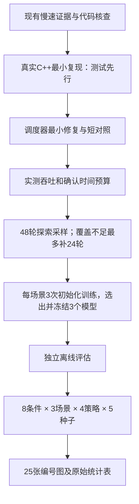

# 越跑越慢的排查与精简实验计划

日期：2026-10-21，Asia/Shanghai。核查起点：`c9492aa`。

**最新状态：用户已授权执行第1～4步；480轮正式实验交给用户手动启动。**
实施进展和最终操作命令见[执行记录](COMPACT_EXECUTION_20261021.md)。以下排查描述保留方案形成时的证据边界。
规划阶段没有修改生产源码、configure、编译，
没有启动或恢复任何实验队列。用户自行启动的手动仿真未被终止；对其中一个进程做了6秒只读CPU采样。
旧批次仍按[停止记录](../../data/experiments/retrain-20261021/plan/user-stop-20261021.json)关闭。

最终规模：**48轮探索采样＋480轮正式四策略对比＝528轮**；
只有预定义覆盖不足才补采，最多再24轮，即最多552个计划独立run。
失败attempt、短诊断和9次模型训练另列；每个job最多执行2次（首次加一次重试），全部耗时计入预算。
相对原918＋4080＝4998轮，起步规模减少约89.4%。这是探索性论文初稿预算，不保证模型或统计精度已经充分。

## 1. 本轮已确认的决定

| 决策 | 用户选择 |
|---|---|
| 时间目标 | 1～2天内优先完整初稿；须以修复后的实测速度核算，不承诺未经测量的工期 |
| 主图 | 三个主自变量、五指标、三场景、四算法；请求数和速度各3点 |
| 车辆数 | 5、10、15、20，共4点；不超过20辆 |
| 正式重复 | 每个条件5个独立种子，四算法配对，共480轮 |
| 图集范围 | 保留旧风格图；固定全网请求数的车辆密度补充扫描暂缓 |
| 训练采样 | 48轮起步，最多72轮；训练覆盖8条件，验证和独立评估先覆盖4个代表条件 |

沿用此前已确认的监督任务：RSU实际可见10×6 hello，标签是业务Data首次回到原请求RSU时车辆的服务站；
每场景一个固定模型，正式实验不改模型和0.10选择规则，不改为强化学习。
本次减少原20种子、缩减条件和范围已有用户明确选择；不继续套用旧规模的强制约束。

设计依赖如下：

## 2. 慢因：已知、推断与尚未验证的部分

### 2.1 手动蜘蛛网并不是20秒时车辆或业务突然启动

默认蜘蛛网为20辆车，计划出发时刻1.0～9.5秒。业务随OBU启动，默认频率参数40Hz，
实际间隔为25ms加0～19.999ms抖动。手动模式没有20秒业务开启阈值。
相反，原批量实验的外部请求计划从20秒测量窗才开始，不能将这两种现象混为一个原因。

保留的手动运行 `data/fgfxf-spider-map/20261021/12-04-48/l3-rate-tracer.txt`
按网络Face汇总的每仿真秒出站包数如下：

| 仿真秒 | Interest | Data |
|---:|---:|---:|
| 15 | 1821 | 1995 |
| 19 | 1628 | 1610 |
| 20 | 1611 | 1603 |
| 25 | 1705 | 1791 |
| 30 | 1681 | 1823 |

没有几十倍的业务包量突增。这不排除Wi-Fi重试、分片等底层成本，且文件没有逐秒墙钟时间，
不能单独用它证明减速倍率。手动grid实际使用哪个输入应以该轮route哈希和入场数为准，
不凭默认文件或命令名称否定用户的10车运行经历。

### 2.2 两种慢进程的CPU热点都集中于事件调度

证据目录：`build/validation/runtime-diagnosis-20261021/`。

| 样本 | 样本量 | 直接指令热点 |
|---|---:|---|
| 原批量圆圈PID30293，12秒 | 1174，lost=0 | ns-3事件插入约19.6%、执行约18.1%、红黑树删除约15.1% |
| 用户手动蜘蛛网PID14818，6秒 | 579，lost=0 | 事件执行20.38%、ns-3事件插入14.68%、红黑树删除13.99% |

文件分别为 `live-cpu-30293-1137.json` / `live-cpu-symbols-30293-1137.json`，
以及 `manual-spider-cpu-14818.json` / `manual-spider-cpu-symbols-14818.json`。
这说明异常并非只出现在批量采集模式；当前采样没有显示训练文件写出是主要热点。
只使用直接指令地址，圆圈采样的调用栈展开不够可靠，不将inclusive排名用于结论。
这些都是局部窗口，不能代表全程精确CPU占比；采样本身有少量开销。

### 2.3 静态核查确认存在重复唤醒路径

重点文件：`src/ndnSIM/ndn-cxx/ndn-cxx/util/scheduler.cpp`。

1. `schedule()`中，新任务早于旧队首时调用`scheduleNext()`。
2. `scheduleNext()`安排新ns-3唤醒并覆盖`m_timerEvent`，没有移除先前已经排队的旧唤醒。
3. `ns3::EventId`是普通句柄，覆盖或销毁它不会自动取消事件。
4. 遗留唤醒执行时会清掉当前句柄，并再次安排下一次唤醒，可能形成多条长期存在的唤醒链。

独立Python控制流演示中，t=0按到期时间倒序加入N个任务：

| N个业务任务 | 当前控制流的唤醒数 | 重排前取消旧唤醒的控制流 |
|---:|---:|---:|
| 10 | 55 | 10 |
| 100 | 5050 | 100 |
| 1000 | 500500 | 1000 |

两者业务回调都各执行一次、按到期时间升序，因此业务日志看似正常也可能存在二次增长的调度成本。
**这是解释器演示，不是实际C++复现，不是实测加速倍数。**

当前与`ns-3_old`的该文件完全一致，SHA256为
`6d814b4c71ec1e4c2cddf34aa434897745ff397b3d625274cc345eeaa58cb329`，
Git来源为初始导入`dd5da43`。它不是本轮采集新增的代码。
目前证据支持将它列为首要原因；仍须真实复现及同输入修复前后对照，才能量化对蜘蛛网慢速的贡献。

其他候选按顺序保留：无线争用/分片重试；7站每站50Hz hello的正常成本；
终端日志、旧CSV逐条打开关闭及NetAnim。暂不改hello频率、无线参数、Data大小来掩盖异常。

## 3. 修复与验证计划：先证明，再最小改动

### 3.1 真实C++最小复现，不运行完整车联网

在ndnSIM现有单元测试自动发现目录新增 `unit-tests/ndn-cxx/scheduler.t.cpp`，
使用真实ns-3模拟时钟及独立NDN Scheduler，不接SUMO、Gym或网络。
不能误用真实steady clock；设置方式参考 `StackHelper::setCustomNdnCxxClocks()`。

首个红灯用例：同context、t=0倒序加入100个不同期限任务，
检查回调各一次、deadline正确、顺序正确，并用`Simulator::GetEventCount()`检查实际内核事件数。
当前控制流推导为5050次而非100次，必须实际运行确认；构建错误不算有效红灯。

随后覆盖：升序/同时间/零延时；取消队首或非队首；重复取消；回调内再次调度；
cancelAll与销毁后无遗留唤醒；跨context；异常退出清理；同纳秒的外部ns-3事件与NDN事件相邻执行。
尤其不能只测“回调执行一次”而漏掉空唤醒数量。

### 3.2 最小修复候选和影响

候选实现仅修改 `scheduler.cpp::scheduleNext()`：重排前移除仍未执行的旧timer、清理句柄，
再为队首保留唯一唤醒。使用Remove避免被取消事件继续占据内核队列，具体代码由红灯约束。
不改四策略转发规则、模型结构、PIT业务逻辑、采集统计口径或路网。

这是公共NDN定时器，作用于所有场景和四策略，也涉及PIT期限、分片重组和周期维护。
它不等同于修改`forwarder.cpp`、`strategy.cpp`、传输/重组协议文件，但影响范围跨这些调用方。
不能承诺全局事件逐位顺序不变：重排会改变ns-3 UID，可能影响同纳秒事件的相对先后。
必须用针对性测试及原始协议记录核对，不能用提速代替正确性。

### 3.3 编译边界和现场验证

- 不执行`./waf configure`，不切换编译profile，不重新触发全量构建。
- C++真正修复必须有局部编译；`export JOBS=4`，只构建`ndnSIM-unit-tests`、
  相关测试及三个场景所需目标/依赖，并显式使用`-j 4`。新增测试使用现有自动发现，不为它重配测试开关。
  单元测试目标链接全部已启用模块，先核对实际增量任务；出现非预期批量重编译则停止核查，不能以configure解决。
  现有测试二进制为`build/src/ndnSIM/tests/ns3-dev-ndnSIM-unit-tests-debug`。
- 对照用旧库/二进制快照隔离保留，不在共享工作区反复回退源码；确认用户手动进程已结束后再构建，
  避免覆盖其运行依赖。短对照不需要另建全量工作区。
- 运行新调度测试和相关既有回归；已经通过且未受改动影响的检查不无限重跑。
- 初始现场对照预算最多12轮短仿真：三场景NoForward旧/新各1轮（6轮），
  神经分支旧/新各1轮（6轮）。先用约25～40仿真秒的小案例，覆盖已开始退化的区间。
  旧版本严重变慢时每轮设置明确墙钟上限，保留失败记录，不把中断前缀称为完整通过。
- 神经分支如暂无对应新真实模型，可用固定测试控制器验证调度与选路链路；明确为工程数据。
  真正新模型的Python→C++动作和无fallback检查放在模型冻结后的正式首批，不用测试控制器替代模型。
- 真实场景按每5～10仿真秒的可观测进度记录墙钟、CPU/RSS和包数，比较业务已开启后的相邻窗口；
  文件缓冲造成的进度延迟须标注。真实事件数由隔离C++测试的`Simulator::GetEventCount()`取得，
  结合已知业务回调数检验重复唤醒，不宣称仅凭进程或包日志能测得完整场景的空唤醒数。
  相同seed/输入比较业务生成、终态、控制报文、时间与动作；差异须解释并形成测试约束。
- VTDF/RTVTDF通过相关单元链路与首个正式四策略块覆盖；发现特定差异才追加针对性旧/新对照，
  不默认重新安排原来几十轮全尺寸工程预检。

只有真实最小复现显示重复唤醒被消除、现场后段退化消除或显著缓解、相关业务检查成立，才将慢因闭环。
若真实红灯未复现，不据Python演示直接修改调度器。
若修复后仍慢，再测无线事件及日志开关；不先大改采集器或缩短仿真来回避问题。

## 4. 精简的8个实验条件

第一版保持预热20秒、测量300秒、排空3.5秒。先减少轮数，暂不同时改变观测时长；
低速场景需要足够交接，不能直接把测量窗缩到“变慢之前”。后续若预算确实不满足，再明确提案调整。

| ID | 车辆数 | 速度km/h | 首次业务Interest总数K | 每车平均频率Hz |
|---|---:|---:|---:|---:|
| B：基准 | 10 | 30 | 15000 | 5 |
| I-low | 10 | 30 | 3750 | 1.25 |
| I-high | 10 | 30 | 30000 | 10 |
| V-low | 10 | 10 | 15000 | 5 |
| V-high | 10 | 50 | 15000 | 5 |
| N5 | 5 | 30 | 7500 | 5 |
| N15 | 15 | 30 | 22500 | 5 |
| N20 | 20 | 30 | 30000 | 5 |

请求轴：I-low/B/I-high；速度轴：V-low/B/V-high；车辆轴：N5/B/N15/N20。
共享基准只运行一次：`1+2+2+3=8`，不是把三个扫描的基准各跑一套。
车辆轴保持每车5Hz，包含密度与请求负载共同增长；固定全网K的密度隔离实验本轮暂缓，图注明确此限制。
最大20辆，不包含原30/40辆压力结论；三点请求/速度曲线只能展示粗趋势，不能据此定位精细拐点。

## 5. 48轮探索采样与最多24轮补采

### 5.1 固定初始清单

| 用途 | 每场景 | 场景数 | 合计 |
|---|---:|---:|---:|
| train | 8条件各1轮 | 3 | 24 |
| validation | B/V-low/V-high/N20，各1轮 | 3 | 12 |
| evaluation | B/V-low/V-high/N20，各1轮 | 3 | 12 |
| 初始合计 | 16 | 3 | **48** |

每个采样run使用独立seed族，不是一个seed遍历所有条件；同一run的全部快照只进入一个用途。
明确列出48项 `(scene, condition, split, seed)`，而不是条件与seed列表做笛卡尔积。
建议新批次使用以下未复用的编号清单：

- train：circle 21001–21008，grid 21009–21016，spidermap 21017–21024。
- validation：circle 31001–31004，grid 31005–31008，spidermap 31009–31012。
- evaluation：circle 41001–41004，grid 41005–41008，spidermap 41009–41012。
- 正式test：51001–51005；每个场景/条件的四策略共享该块相同输入与seed。
- 诊断另用11021起的独立编号；补采分别预留220xx/320xx/420xx，始终不跨用途。

现有规范化、短/空历史、非法标签排除、TIMEOUT合法标签、运行边界及哈希校验全部保留。
原中断pilot仅作诊断，不能当成正式完整采样；旧CSV不冒充新的实际回程标签数据。

### 5.2 质量检查与补采触发

完成初始采样后先检查：三个split分别覆盖场景全部2/7类；存在真实跨站交接样本；
列出每类/条件/车辆/seed的支持数、无效/短历史、排除原因及同站/跨站比例。
类缺失与空数据仍为硬错误；少量样本只能报告为稀少，不能凭数万相邻窗口宣称独立样本充分。

仅按预定义的缺类、缺交接或运行无有效样本的覆盖问题启用补采，
优先补相应用途、场景和可产生该类别的合法路线条件；不看正式测试结果挑条件。
补采总上限24轮，建议每场景最多8轮；不能从其它split挪样本、覆盖不利数据或无限追加。
达到上限仍不满足基本标签/数据要求，应报告不满足；不是自动放宽训练检查。
失败重试单独计数和计时，每个job只允许一次重试，不把无限重试藏在24轮补采之外。
失败原因为确定性配置/程序错误时先停止处理原因，不原样重复；重试仍失败则保留失败并报告。

补采属于显式设计修订：保留旧设计哈希和全部旧job定义/manifest，仅追加新job，
核验旧项不变再更新状态身份，记录原因、批准范围及新哈希。
不直接在已经运行的JSON里随意添加seed，不删改执行身份校验来强行续跑。

### 5.3 探索范围限制

每个训练条件只有一个随机实现，这是探索性起点，不保证泛化或Neural优于VTDF。
独立离线评估只含B/V-low/V-high/N20四个代表条件，未单独覆盖I-low/I-high/N5/N15。
N20/K30000不能代替N10/K30000，因为每车发包强度不同。
离线混淆矩阵应写“四个预定代表条件”，同时给出分条件支持数与结果；
480轮在线正式对比才覆盖全部8条件。
每条件仅一次离线评估，不将跨条件bootstrap当作同条件多seed稳定性证据。

## 6. 训练与模型冻结

保持TKAN-LSTM、10×6输入、hidden32、既有类别权重与归一化规则。
每场景仍做3个初始化，共9次训练；只用train拟合，validation选模和早停，
先沿用最多100epoch/patience15，不新增结构搜索。
记录实际训练吞吐；若明显超出预算，在查看独立评估和正式结果之前统一调整训练预算并封存，
不按最终策略排名挑超参数或阈值。

输出每场景一个checkpoint、训练曲线、选模依据、数据清单/源码哈希及固定0.10选择规则。
最终模型冻结后才运行独立评估预测及正式测试，绝不看到正式结果后回头换模型。
报告分类、跨站目标覆盖与在线交付各自的结果，不把一种准确率替代全部指标。

## 7. 正式480轮的顺序与验收

`3场景 × 8条件 × 4策略 × 5seed = 480`。

1. 先执行三场景基准、首个正式seed的四策略，共12轮。源码/模型/种子在此前冻结，
   所以这12轮本来就属于480轮，不另复制一套全尺寸工程预检。
2. 检查真实模型控制器连接、Python/C++概率与目标站一致、无意外fallback、请求闭合、实际车辆覆盖。
   算法表现不好本身不能判失败或丢弃；VTDF/RTVTDF也不以优于某策略作为验收门槛。
3. 按seed分批遍历其余场景/条件/四策略，完成预定5seed，不能看曲线好坏提前停止。
4. 逐轮保留配置、输入、模型、源码/二进制证据、墙钟/内存、原始事件及汇总。
   中断/缺算法/缺seed不填补成成功；暂停恢复只复用验证过的完整job。

正式批次始终串行，先保证正确性与端口隔离；不把启动多个抢占同一Gym/SUMO端口的进程当加速方案。
所有实验入口显式使用`--run-no-build`。`JOBS=4`只限制编译，并不使单轮仿真自动变为四核。

## 8. 图与统计交付：25张编号图，复用同一批数据

| 交付 | 数量 | 数据来源 |
|---|---:|---|
| 三自变量×五指标；每张三场景子图、四算法 | 15 | 480轮完整配对矩阵 |
| 旧风格RTT随时间三维图 | 3 | 正式基准条件；代表seed事前固定为51001 |
| 三种补救策略RTT箱线图 | 3 | 正式基准五seed；展示完整分布和交接尾部，保留离群值 |
| 基准网络流量对比 | 1 | 同一基准结果，不额外仿真 |
| 三场景独立评估混淆矩阵 | 3 | 四个预定代表条件的evaluation |
| 合计 | **25** | 固定K补充5图本轮暂缓 |

输出PDF/SVG/PNG、CSV统计表、figure-index、中文/英文图注及来源。
学习曲线、ECDF、协议负载分项等诊断复用现有数据；不为每张图单独再采一次。
旧图可以保留原编号间隔，例如固定K对应F16–F20注明延期，不用假图填齐30张。

指标口径保持不变：首次业务请求分母的ISR、成功请求加权平均RTT、L3出站网络/控制Mbit，
应用显式额外Data提交次数。最后一项不是所有实际空口副本；负载不含LP/MAC重试，图注不得省略。
控制负载沿用已核实协议分类；失败请求不能从ISR分母删除，零成功时RTT不填0。

每点仅5个独立重复。除RTT外，主图显示各run指标的均值、种子点和标准差。
RTT中心保持`全部成功请求的RTT之和 / 全部成功请求数`，不改成各run平均RTT的算术均值；
各run平均RTT散点及其标准差另表征运行间离散程度，图注明确其与加权中心的区别。
若附95%bootstrap区间，必须按完整配对seed重采样，并标明小样本不稳定。
10000次bootstrap不能变成10000次独立实验；不预先宣称显著优于或统计非劣。
箱线图的包级样本用于分布展示，不能充当几万个独立重复。

## 9. 必要修改范围和影响

| 文件/模块 | 修改目的与边界 |
|---|---|
| ndn-cxx `util/scheduler.cpp` | 测试确认后只修复唯一唤醒不变量；公共NDN定时器，影响所有场景/策略 |
| `src/ndnSIM/tests/unit-tests/ndn-cxx/scheduler.t.cpp` | 新增真实时钟/事件数量/取消/context回归，使用现有自动发现 |
| `tools/experiments/campaign.py` | 新设计配置：8条件、3/3/4点、5正式seed；显式48项采样job，避免条件×seed膨胀；采样清单进入身份哈希 |
| 同上设计修订入口 | 有界、仅追加的补采；保留旧job与证据，不能放宽旧结果身份检查 |
| `run_experiment.py`及调用处 | 正式支持no-build运行方式，保存实际命令，停止依赖临时monkeypatch包装 |
| `aggregate_campaign.py` | 按声明冻结设计检查完整矩阵，移除只适用于旧设计的20/17/每轴5点硬编码；固定K可选 |
| `plot_campaign.py`、`campaign_workflow.py` | 按图清单生成/核验25图，支持3/3/4点；显式采样导出、离线评估范围记录 |
| 新接续入口（拟为`tools/experiments/run_campaign_pipeline.py`） | 读取新冻结设计，复用现有采样/训练/测试/出图命令；替代旧临时入口硬编码的510/153/255采样和4080正式轮数，不恢复旧队列 |
| 相关Python测试 | 48初始/最多24补采/480正式计数；缺job/算法/seed拒绝；跨split泄漏拒绝；同seed换条件导致身份变化；旧设计兼容；25图真实渲染 |
| 只读进度入口及AI文档 | 显示具体job、完成轮数、仿真秒/目标秒、最后数据更新时间、耗时；把阶段状态与实时进度分开 |

`formal_data.py`已经接受不同split的任意run清单，原则上不改样本格式；
保留其缺类、种子和实际随机元组泄漏检查。训练网络、四算法、底层传输/重组与原模型均不因缩轮改变。
缩减方案仍是真实实验`validation_only=false`；不能靠改成true绕过旧20/17限制。

建立新目录如 `data/experiments/retrain-compact-20261021/`，源码修复与工具修改验证后才冻结新哈希。
旧`retrain-20261021`、旧模型、失败attempt及用户提交保留，旧队列不恢复。

## 10. 时间预算、执行边界和完成标准

起步528个计划独立run；覆盖补采到上限则552个。失败attempt和短诊断另列并计入时间预算。
单轮成本必须取修复后实际情况，按场景/参数/策略分层，
不能用最轻手动circle或最慢旧circle代表全部。首批运行同时计时，不再额外跑42轮资源pilot。

以下仅是吞吐条件换算，不是承诺：

| 平均每轮墙钟 | 528轮仿真 | 另预留约6小时诊断/训练/出图后的总量 |
|---:|---:|---:|
| 1分钟 | 8.8小时 | 14.8小时 |
| 2分钟 | 17.6小时 | 23.6小时 |
| 3分钟 | 26.4小时 | 32.4小时 |
| 5分钟 | 44小时 | 50小时 |

不发生额外失败attempt时，两天内完成要求起步方案平均约不超过4.77分钟/轮；补采上限方案约4.57分钟/轮，
且6小时预留本身仍需实测。有失败重试时可用时间进一步减少。
用分层时间合计、失败成本和余量更新ETA，不因队列存在就声称按期必成。
若性能修复后仍明显超出预算，报告具体成本与可选缩减；不再次默默启动数百轮长跑，
也不擅自把已确认的5seed或20车上限改成更方便的数字。

实施顺序为：真实红灯 → 最小修复 → 新测试/相关回归及有界短对照 → 新工具测试 →
新批次冻结 → 48轮与覆盖审核 → 必要有界补采 → 三模型训练/冻结 → 独立离线评估 → 480轮 → 25图。
最后必须交付真实图集及数据来源、未覆盖范围和耗时记录；仅启动后台脚本不叫完成。

用户随后已确认执行第1～4步，包括公共调度器修复和必要局部增量编译；
准备流水线应在三模型冻结并完成独立评估后停止，正式480轮提供可手动执行的命令。
旧实验队列仍不恢复。进度显示阶段、当前/完成/剩余轮数和已用时间，不估算剩余时间。
