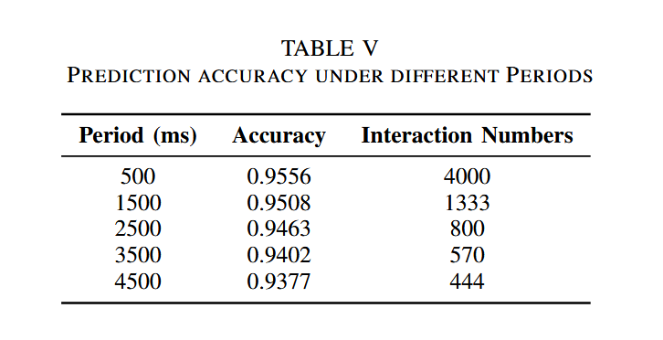
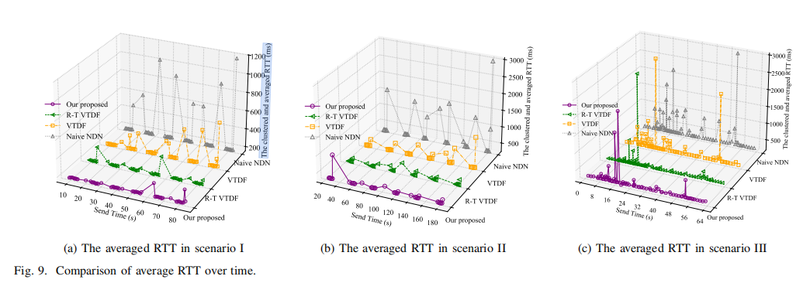
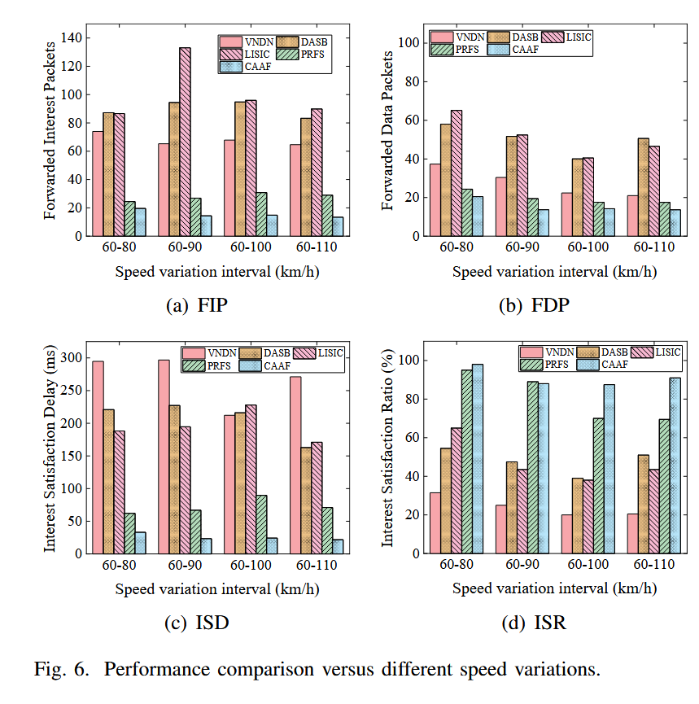
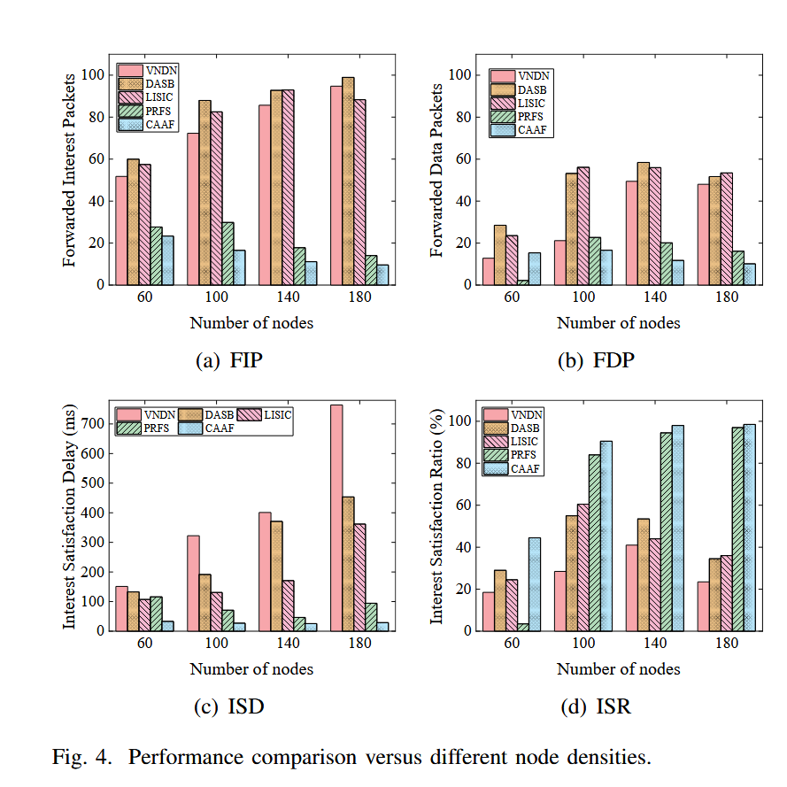
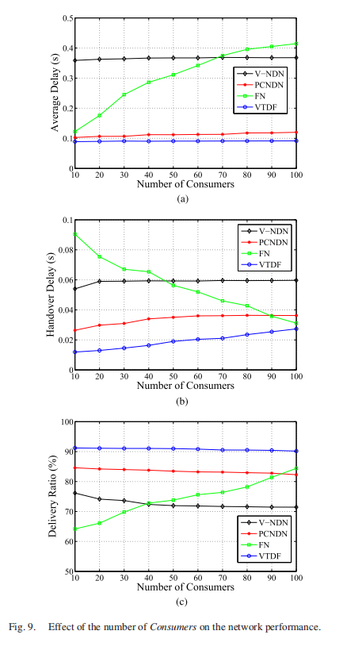
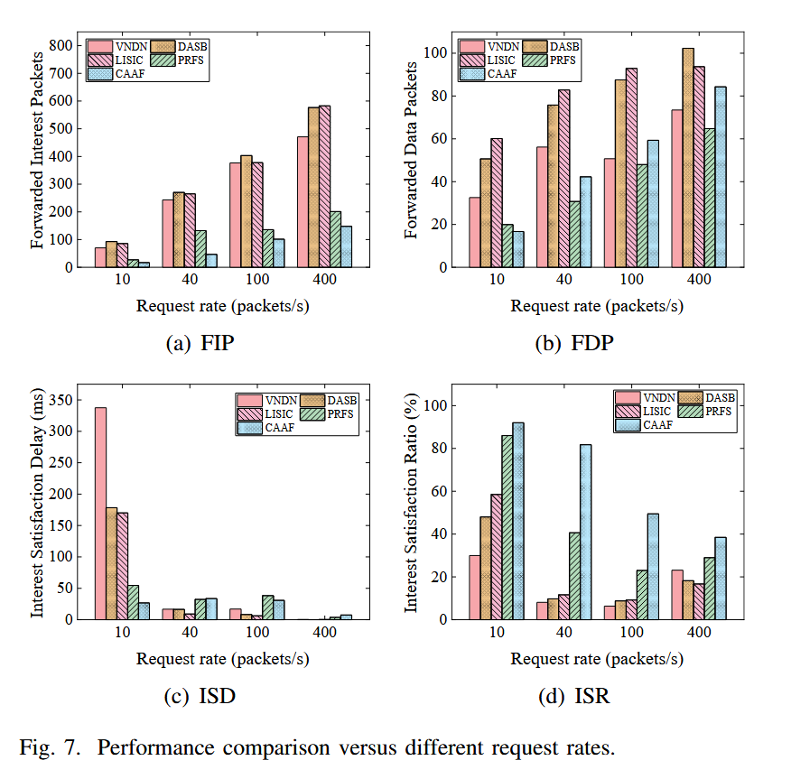

# 仿真图

> 来源：`ns-3_old/旧的实验效果图/仿真图.docx`；转换日期：2026-10-25。

## 1、不同信标周期下预测准确度（三个场景都写）

首先可以观察到，预测准确率随分发周期的增大而逐渐下降。这是因为较长的分发周期会降低车辆周期性获取的 CIT 的准确性，进而降低基于历史 CIT 进行预测的准确率。另一方面，随着周期增大，车辆与 RSU 之间的信息交互次数减少，产生的额外开销也随之降低。因此，预测准确率与开销之间存在权衡。值得注意的是，即使分发间隔较长（例如 4 秒，原文称其为请求速率的 40 倍），预测准确率仍能保持在较高水平（超过 90%）；当分发周期为 1 秒时，预测准确率甚至超过 95%。这表明，我们的预测模块能够显著提高所采集数据的准确性，并取得优异的性能。综合权衡预测准确率与额外开销，我们在后续实验中将分发周期设为 T = 2 秒。

## 2、NVT、NCT两个表大小，更新和注册两个数据包大小、TKAN推断时延

通信开销：针对算法的通信开销，我们为每辆车引入了一种新的数据结构 CIT。CIT 的结构如表 II 所示，其大小约为 4 字节，远小于数据包。此外，CIT 的同步时间间隔 T 也远大于用户的请求速率。因此，CAAF 产生的额外通信开销远小于数据传输开销，不会影响数据传输。该算法的计算开销和通信开销均随车辆数量线性增长。由于车辆和内容条目的数量通常有限，我们提出的缓存感知自适应转发策略所产生的额外开销仍处于可控且可接受的范围内。

## 3、对比实验图，性能指标：二次转发数据包数量、平均RTT（平均满足时延，毫秒）、兴趣包满足率、网络负载：

### 1）场景图（纵坐标：平均满足时延）

证明我们所提算法TKAN-PDF在三个场景均具有优势

### 2）车辆速率：速度变化区间（千米/小时）

不同移动场景下的性能。我们通过改变车辆速度的变化幅度，评估各转发策略在不同移动场景下的性能。

速度变化幅度增大会使网络拓扑更加不稳定，链路的稳健性降低，数据包的成功传输比例随之下降。

### 3)消费者数量（包/秒）

不同节点密度下的性能。我们通过改变节点数量，评估各转发策略在不同节点密度下的性能。

描述参考《命名数据网络中面向车辆跟踪的数据转发方案》，该实验图如下图所示。

在图 9(a) 中，随着消费者数量增加，FN 的平均时延显著增大，而 V-NDN、PCNDN 和 VTDF 的平均时延趋于稳定，其中 VTDF 的平均时延最小。这是因为 FN 采用车车（V2V）通信模式，其性能依赖于车辆节点密度。V-NDN、PCNDN 和 VTDF 则采用车路（V2R）通信模式，消费者数量的变化对它们的影响相对较小。VTDF 采用通过数据包跟踪车辆的路由恢复方法，以减少数据包丢失和不必要的兴趣包重复请求。同时，VTDF 在数据转发过程中还采用了特定的缓存方法，以提高数据内容的缓存命中率，使其平均时延表现优于 PCNDN、FN 和 V-NDN。

### 4)发包率（请求速率）

不同请求速率下的性能。我们评估各转发策略在不同请求速率下的性能。如图 7(a) 和图 7(b) 所示，随着请求速率提高，所有策略的 FIP 和 FDP 均有所增加。这是因为较高的请求速率会使数据包数量增加，并引发网络拥塞。
