# 仿真图

## 1、不同信标周期下的预测准确率

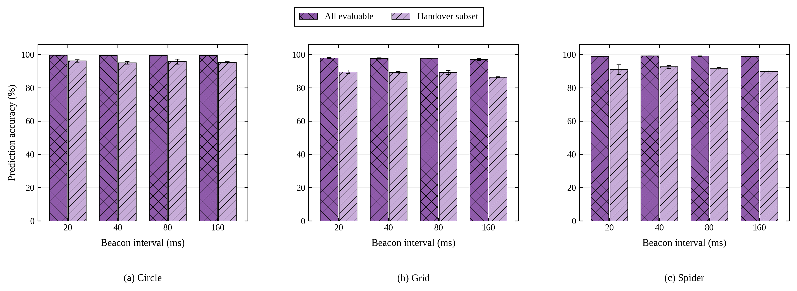

## 2、状态表规模、注册与更新报文大小、TKAN推理时延

### 1）车辆—内容映射表与内容—车辆映射表的条目数

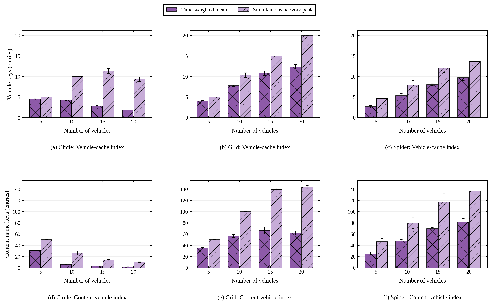

### 2）注册与缓存增量更新报文大小

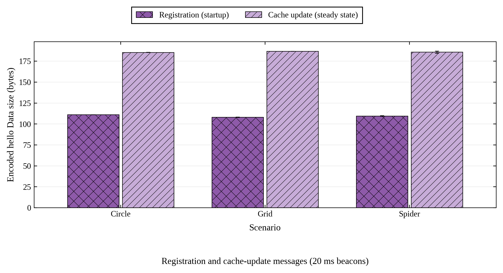

### 3）TKAN推理时延

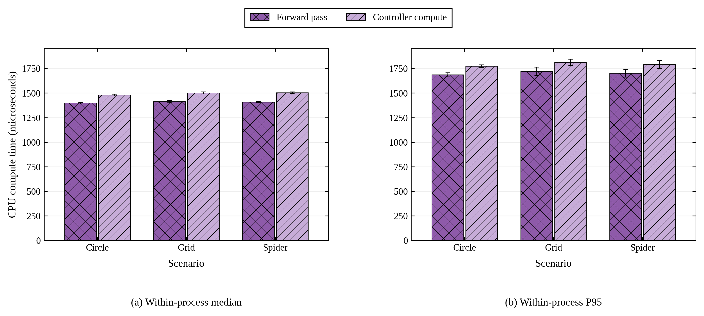

## 3、对比实验图

### 1）三场景RTT时间变化

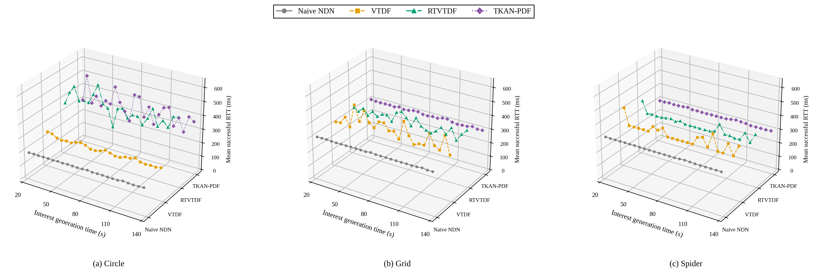

### 2）车辆速度设置

#### 圆圈场景

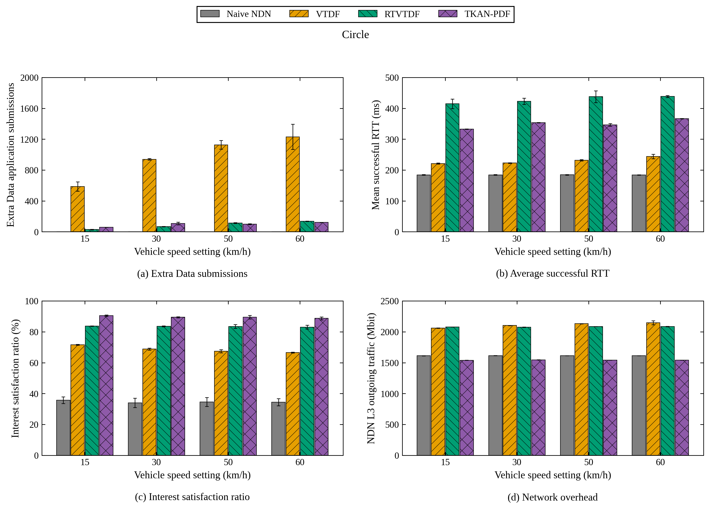

#### 方阵场景

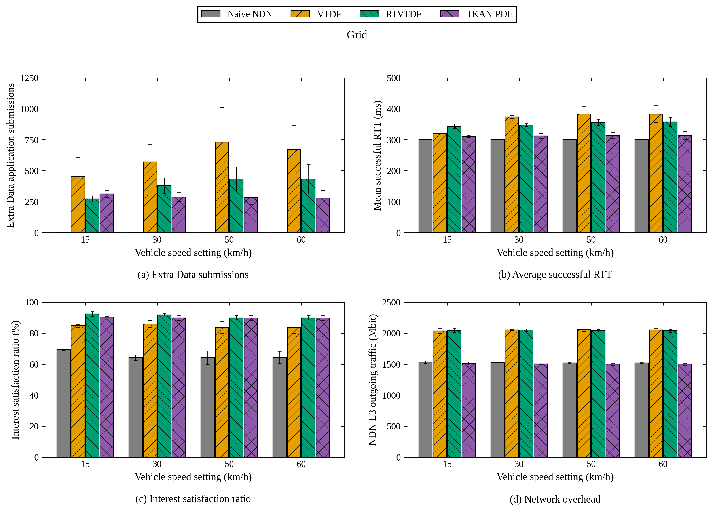

#### 蜘蛛网场景

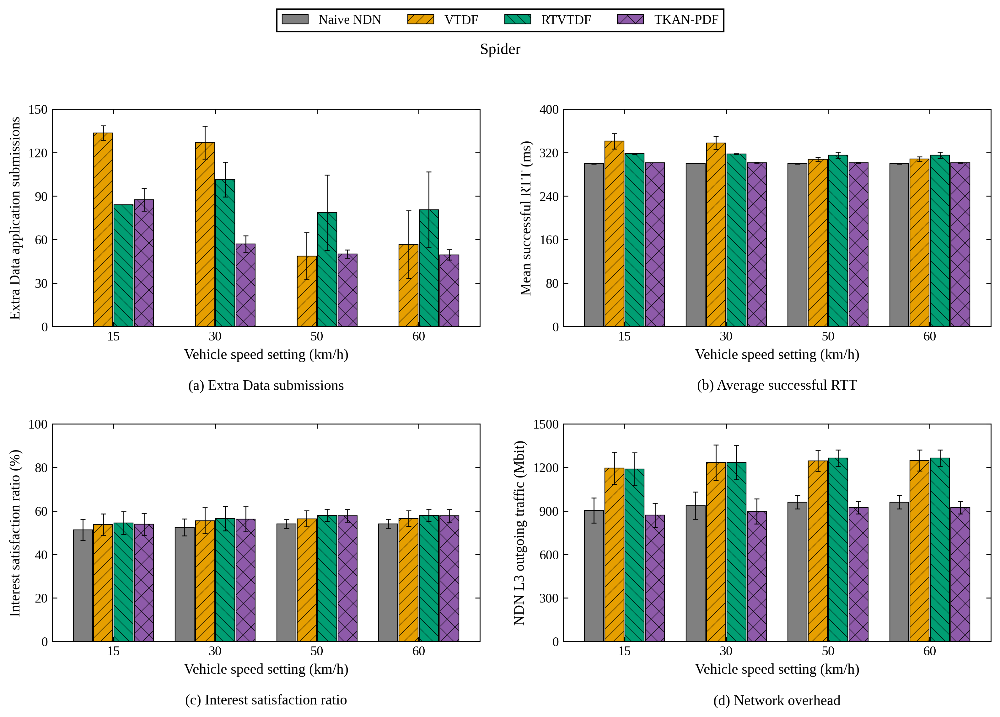

### 3）消费者数量

#### 圆圈场景

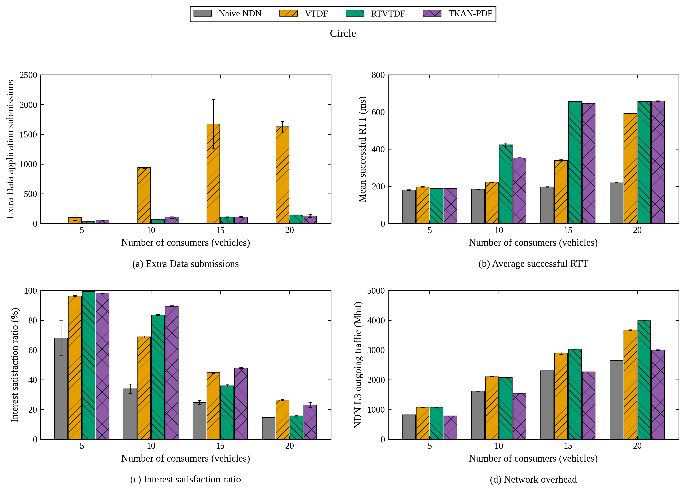

#### 方阵场景

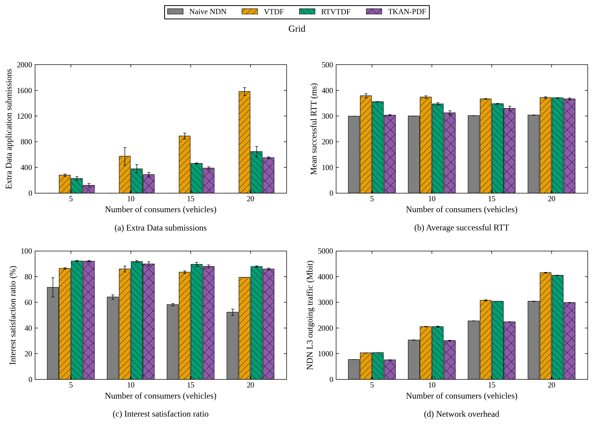

#### 蜘蛛网场景

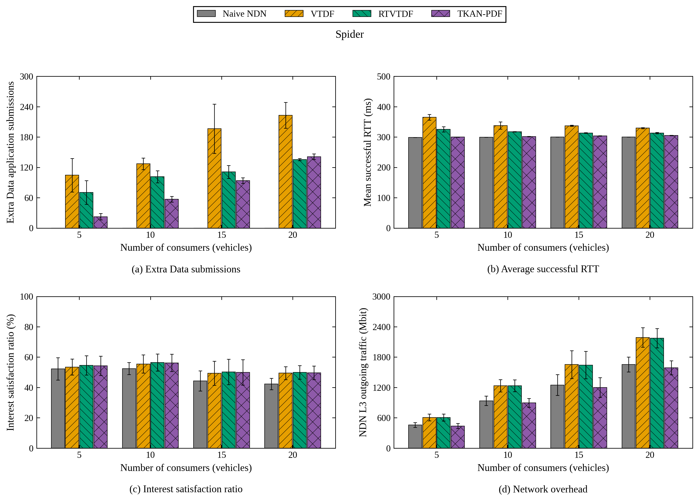

### 4）请求速率

#### 圆圈场景

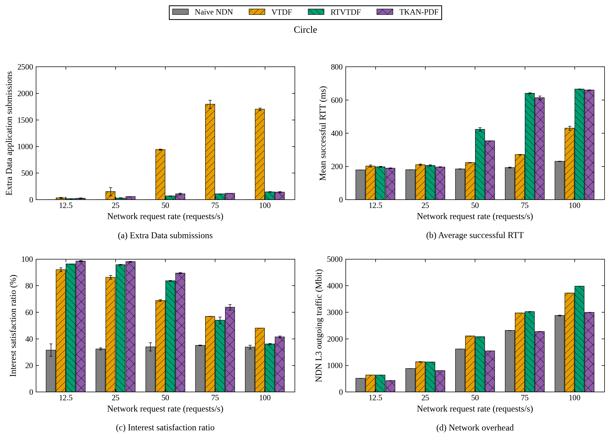

#### 方阵场景

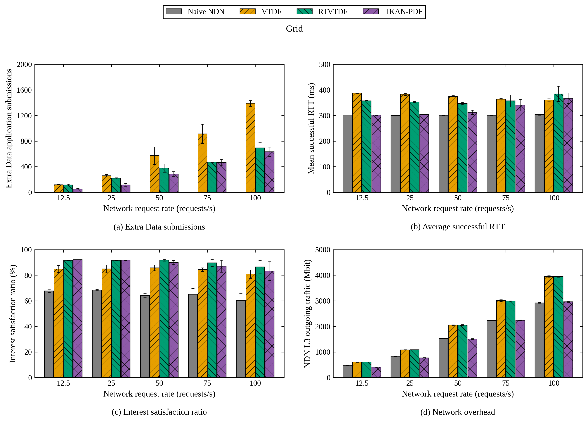

#### 蜘蛛网场景

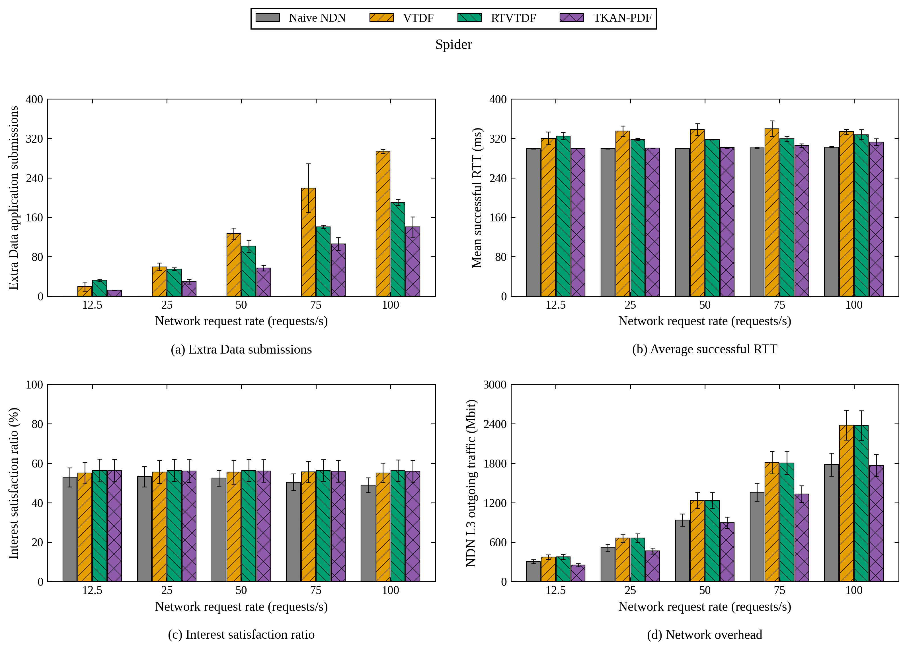
