# 仿真图

## 1、不同信标周期下的通信准确率

（跨基站请求时的基站选择准确率与送达准确率）

| Period (ms) | 圆圈 | 方阵：Top-2 | 蜘蛛网 |
| --- | ---: | ---: | ---: |
| 20 | 96.10% | 91.69% | 36.06% |
| 40 | 92.77% | 86.42% | 30.50% |
| 80 | 87.30% | 82.88% | 26.18% |
| 160 | 71.43% | 82.80% | 24.57% |

圆圈、蜘蛛网：速度60 km/h，种子85001，每档1轮；方阵：速度设置30 km/h，种子84001/84002/84003，每档3轮取均值。均为10车、6000请求。

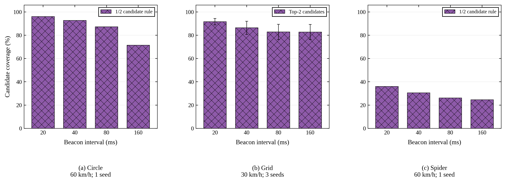

## 2、状态表规模、注册与更新报文大小、TKAN推理时延

### 1）两张缓存映射表的单条大小

| 表 | 单条大小估算（B） |
|---|---:|
| 车辆→缓存内容集合 | 700 |
| 缓存内容→持有车辆集合 | 200 |

### 2）控制包大小

| 控制包 | 圆圈（B） | 方阵（B） | 蜘蛛网（B） |
|---|---:|---:|---:|
| registration | 111.00 | 108.07 | 109.57 |
| update | 185.46 | 186.79 | 185.75 |
| hello Interest | 32.00 | 32.00 | 32.00 |
| neural-route | 85.31 | 85.63 | 85.29 |
| neural-pit | 111.73 | 112.22 | 112.18 |

### 3）TKAN推理时延

| 场景 | 模型前向（ms） | 控制器计算（ms） |
|---|---:|---:|
| 圆圈 | 1.398 | 1.480 |
| 方阵 | 1.413 | 1.502 |
| 蜘蛛网 | 1.409 | 1.504 |

## 3、对比实验图

### 1）三场景RTT时间变化（Spider：16.5 dBm，5种子汇总）

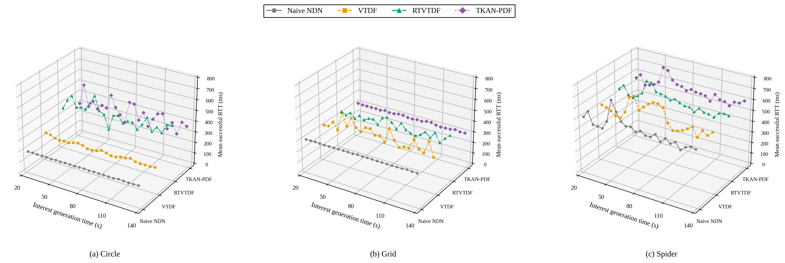

### 2）车辆速度设置

#### 圆圈场景

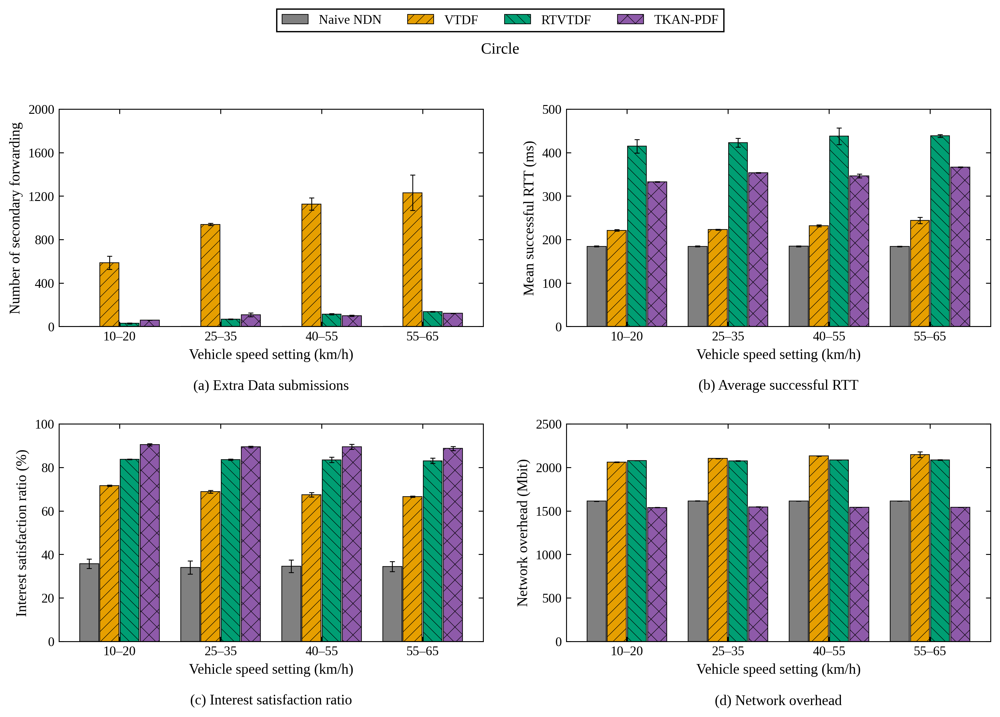

#### 方阵场景

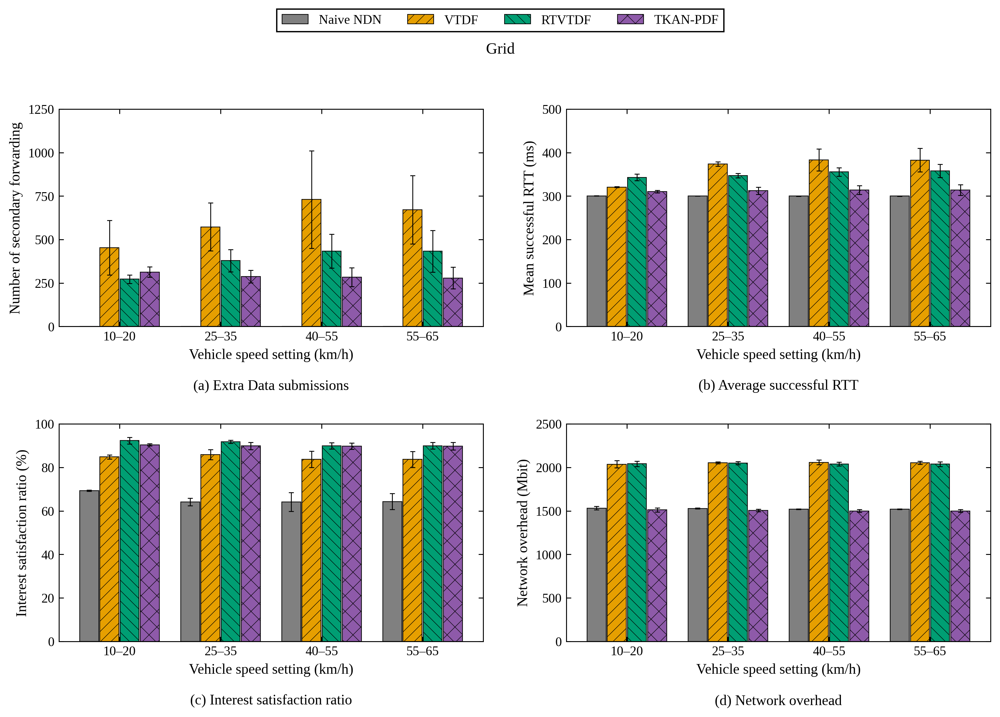

#### 蜘蛛网场景

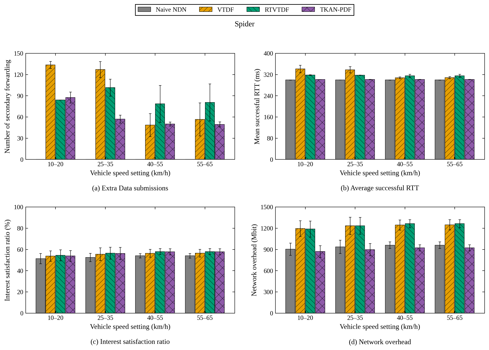

### 3）消费者数量

#### 圆圈场景

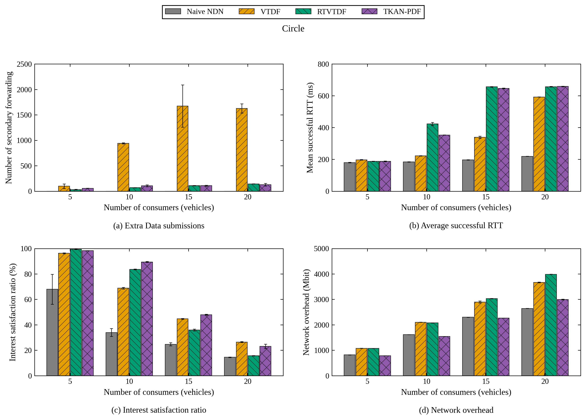

#### 方阵场景

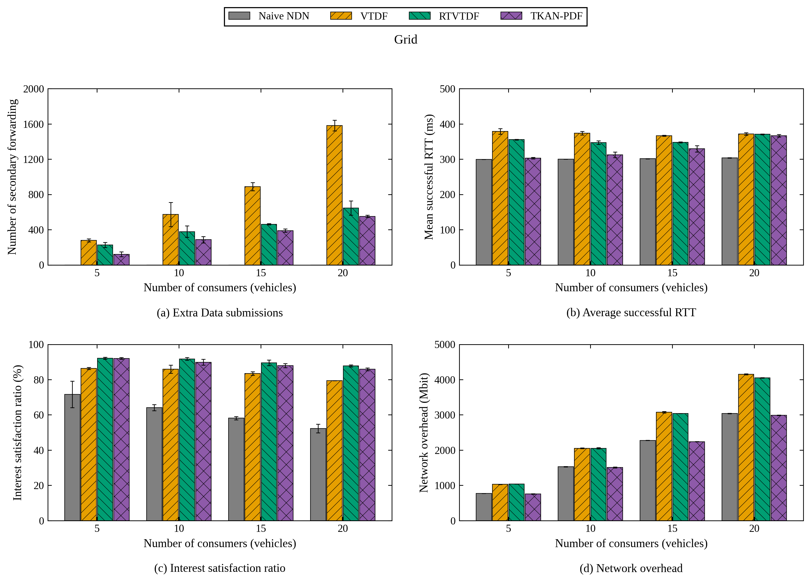

#### 蜘蛛网场景

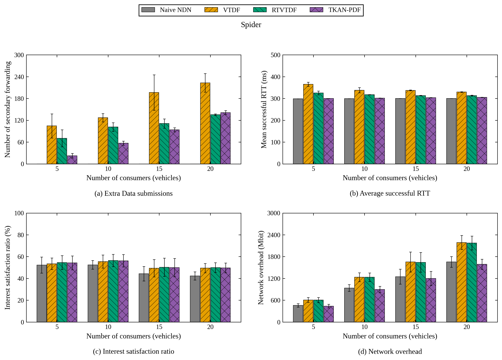

### 4）请求速率

#### 圆圈场景

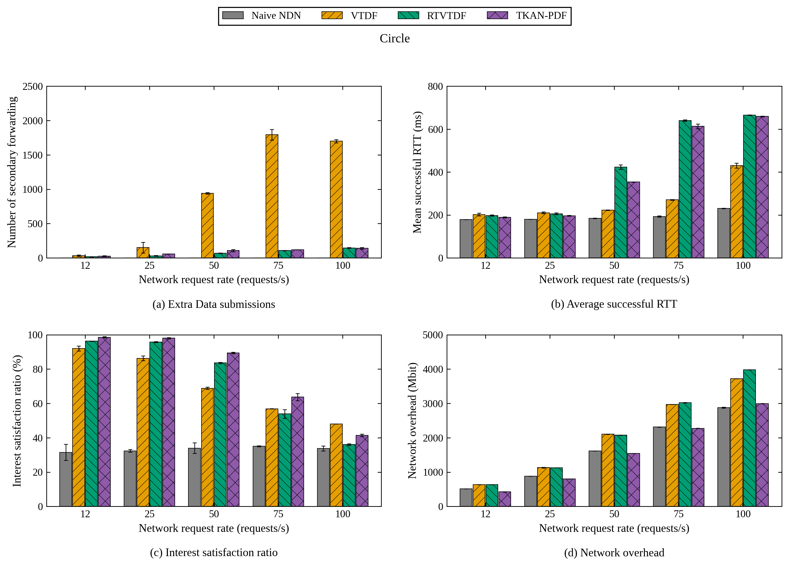

#### 方阵场景

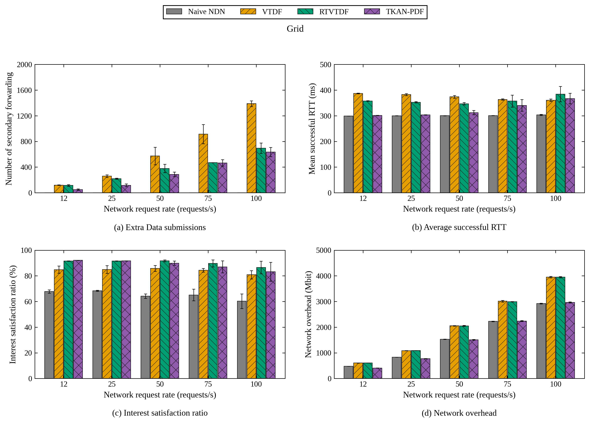

#### 蜘蛛网场景

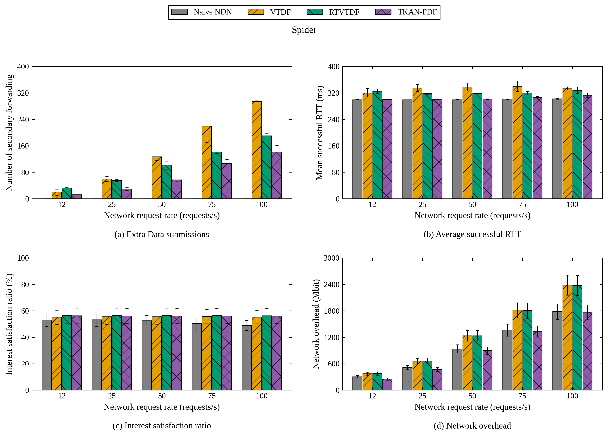
