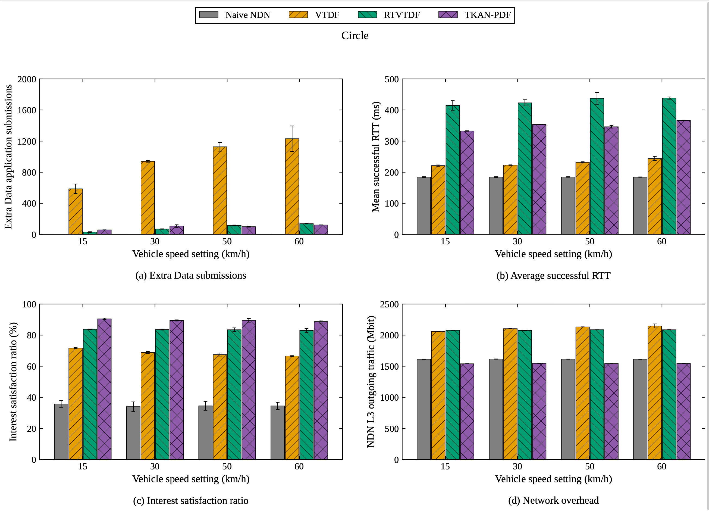

# 平均RTT统计说明

本次仅调整文件名与正文展示名称，统计定义和数据不变。成功请求RTT与平均RTT使用不同分母，不可混用。

**下方两图使用与成功RTT图相同的28轮原始请求记录和5秒分箱，将每个窗口内生成的全部请求纳入均值：成功请求计从发送到收到 Data 的实际耗时，超时请求计从发送到超时终结的实际等待时间。本批超时均严格为3000 ms。因此，每箱平均 RTT＝（成功请求实际耗时之和＋3000 ms×超时数）÷该箱生成请求数。该指标包含失败请求的等待代价，并非只对成功收包求平均。按用户要求，图轴统一写 Mean RTT (ms)。**

**原始记录共168000个请求，其中71510个成功、96490个超时，无其他终态；Circle/Grid每个“场景×策略×5秒箱”有250个生成请求，Spider合并5轮后每箱1250个。Spider本身共120000个请求、34628个成功、85372个超时。样本按生成时刻归箱，即使请求在箱外或排空期才结束，其完整耗时仍计入原生成箱。两种图形只改变展示方式，不改变各自统计值；本次正式曲线全部复用保存数据；默认功率另做工程短测，其结果不进入图表。逐箱计数、成功/超时耗时总和及两种均值见[RTT分箱数据.csv](问题图片/RTT分箱数据.csv)，CSV保留672行原始“场景×策略×种子×5秒箱”，Spider绘图时每5行同策略同时间箱合并，最终每图288个绘图值。原始路径、种子与摘要见[RTT数据来源.json](问题图片/RTT数据来源.json)。**

**两组图的差异首先来自实验数据和统计定义不同，不能只通过调整画法把曲线变成一样。旧图是旧手写实现的历史数据；原图集图5和上方成功请求 RTT 两图使用重写版本的固定模型实验数据，按5秒分箱，只统计期限内成功请求的 RTT。旧归档 RTT CSV 同时记录成功收包和超时终结耗时，包含大量3000 ms记录；旧三维脚本还按每20条（圆圈）或40条（方阵、蜘蛛网）记录分组平均，而非固定5秒分箱。本次新增的含超时平均 RTT 两图已纳入超时等待，但仍保留当前实验的数据、种子和5秒分箱，不能与旧图视为同条件复现。**

**因此旧图中 Naive 的较高尖峰可能含超时耗时，上方成功请求图中的 Naive RTT 较低也不代表其交付更好：未成功的请求没有进入成功 RTT 均值，而新增含超时图会计入这部分等待代价。实现、模型、发包与取样方式也存在差异。虽然已提供二维版式，若要比较新旧算法性能，仍需要相同条件、相同成功/超时口径的对照，不能靠改图复现原来的优势。来源：[旧论文实验与出图记录第4～5节](旧论文实验与出图记录.md)、[当前图集口径](仿真图填充/使用说明.md)。**

