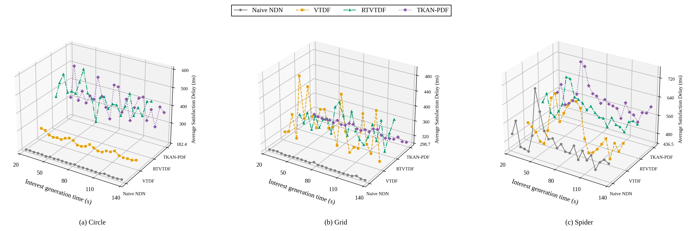
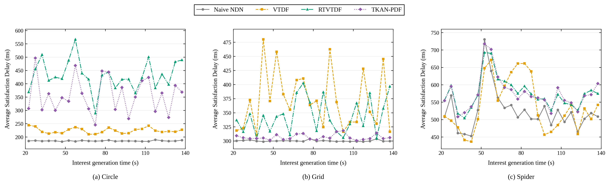
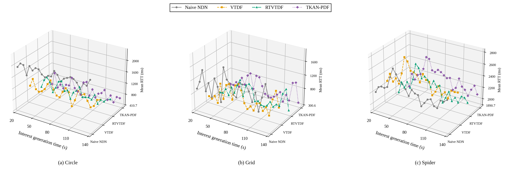
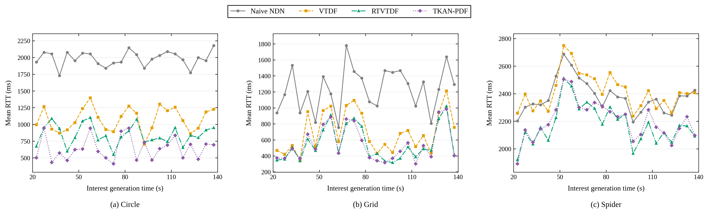
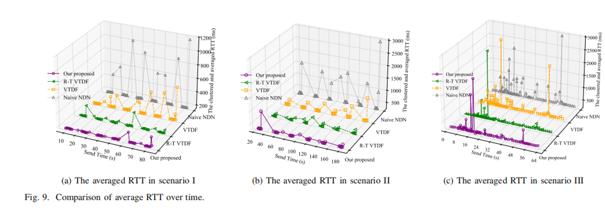
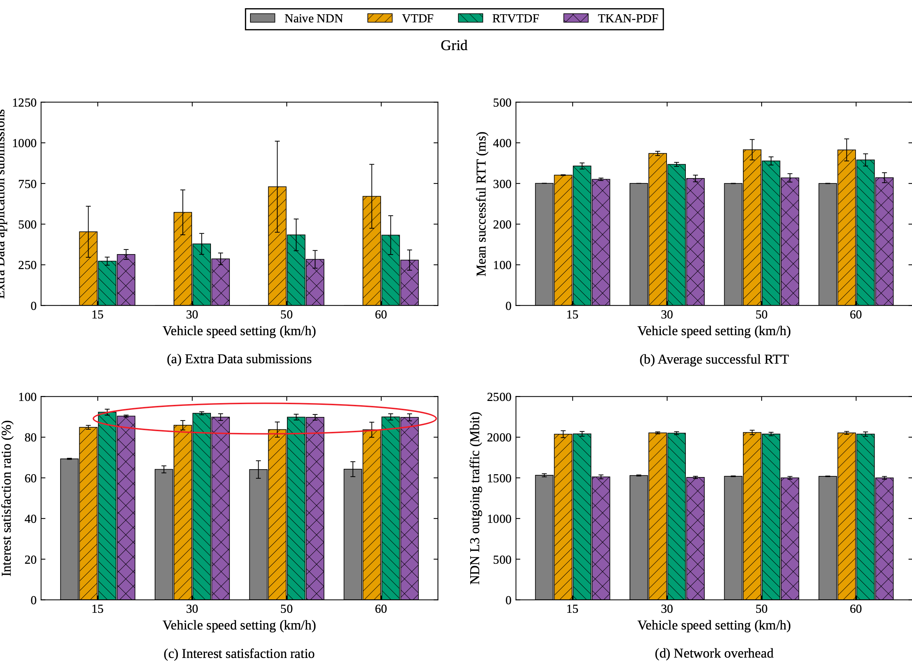

# 问题

**填写依据：[仿真图填充/仿真图.md](仿真图填充/仿真图.md)及同目录绘图脚本内嵌数据；正文解释补充核对了保存的实验记录和当前实现。以下加粗文字为新增回答，原问题和截图保留。**

# 神经网络决策推理时间

**下表单位为微秒（μs），每格为“柱高 ± 误差线”，误差线为5个进程统计值的样本标准差，不是置信区间：**

| **场景** | **(a) 前向中位数** | **(a) 控制器中位数** | **(b) 前向P95** | **(b) 控制器P95** |
| --- | --- | --- | --- | --- |
| **圆圈** | **1398.36 ± 8.35** | **1480.18 ± 8.52** | **1686.55 ± 21.31** | **1774.45 ± 13.18** |
| **方阵** | **1413.04 ± 10.79** | **1501.73 ± 10.48** | **1721.88 ± 42.84** | **1813.06 ± 32.38** |
| **蜘蛛网** | **1409.10 ± 7.22** | **1504.06 ± 9.14** | **1701.93 ± 40.06** | **1791.08 ± 40.25** |

**测量环境为 Intel Core i7-14700、CPU单线程、batch=1，每个进程预热100次；排除模型加载、Gym等待和I/O。来源：[图4脚本](仿真图填充/04_TKAN推理时延.py)与[计时实现](../../tools/experiments/followup_benchmark.py)。**

update和registration两个数据包大小（具体数值）、TKAN推断时延（写数值即可）

**对应图3和图4，可直接填写以下数值；时延采用纯模型前向的进程内中位数之跨进程均值，换算为毫秒：**

| **场景** | **update：平均完整NDN报文大小（B）** | **registration：平均完整NDN报文大小（B）** | **TKAN推断时延（ms）** |
| --- | --- | --- | --- |
| **圆圈** | **185.46** | **111.00** | **1.398** |
| **方阵** | **186.79** | **108.07** | **1.413** |
| **蜘蛛网** | **185.75** | **109.57** | **1.409** |

**报文数值对应 TKAN-PDF 在线运行、10辆车、20 ms信标周期；registration 取启动窗 [0,20) 秒的注册回复，update 仅取测量窗 [20,140) 秒中有缓存增删的 delta 回复，不包括所有无变化 hello。先计算各轮平均包长，再平均三个种子，所以有小数；是完整 hello Data 大小，不含 LP/MAC 开销，也不是固定的包长常量。启动时缓存为空或很少，而后续增量可能携带新增和删除名称，因此本组 update 均值大于 registration 均值。若需包含输入处理等完整控制器计算，其中位数均值分别为1.480、1.502、1.504 ms。来源：[图3脚本](仿真图填充/03_注册与更新报文大小.py)、[图4脚本](仿真图填充/04_TKAN推理时延.py)。**
**成功请求 RTT：三维图（由下方独立脚本生成）**

这张图线条和标注都没有对齐，干脆不要弄成三维图了，横坐标Interest generation time，纵坐标 Average Satisfaction Delay （ms）

**已增加圆圈、方阵、蜘蛛网三个并列的二维折线子图，每个子图保留四条策略曲线；横轴为 Interest generation time (s)，纵轴为 Average Satisfaction Delay (ms)，策略名称放在图例中。成功请求的三维图和折线图使用同源统计的288个绘图值，与[原图5脚本](仿真图填充/05_三场景RTT时间变化.py)一致。**

**统计窗口为请求生成时刻的 [20,140) 秒，每5秒一箱，横坐标为各箱中心22.5、27.5……137.5秒。Circle、Grid分别沿用23001、23009种子的原单轮基准；Spider使用2026-11-03保存的16.5 dBm独立复核种子93001～93005，每策略5轮，RSU与OBU均为16.5 dBm。每箱合并所选种子的成功请求，以成功耗时总和除以成功数，按成功请求数加权，不对各轮成功均值简单平均。空分箱保持缺失，不补0。**

**平均RTT：三维图与折线图**

**下方两图展示三场景平均RTT，使用28轮保存的请求记录，按请求生成时刻每5秒分箱。纵轴为 Mean RTT (ms)。统计方法见[平均RTT统计说明](../平均RTT统计说明_20261117.md)。**

**原始记录共168000个请求；Circle/Grid每个“场景×策略×5秒箱”有250个请求，Spider合并5轮后每箱1250个。两图使用相同统计值，仅展示方式不同。逐箱数据见[RTT分箱数据.csv](问题图片/RTT分箱数据.csv)，原始路径、种子与摘要见[RTT数据来源.json](问题图片/RTT数据来源.json)。**

**两个三维图均按场景独立设置 z 轴下限，取该场景四条曲线的实际最小值；保留真实 RTT 刻度，不把数值减去最小值后归零。成功 RTT 图的圆圈/方阵/蜘蛛网下限约为182.39/298.72/436.55 ms，平均RTT图约为410.68/300.59/1890.73 ms；因此子图坐标范围不同，比较时应看刻度和数值。**

| **内容** | **独立出图脚本（数据内嵌）** |
| --- | --- |
| **成功请求 RTT 三维图** | **[01_成功RTT_三维.py](问题图片/01_成功RTT_三维.py)** |
| **成功请求 RTT 折线图** | **[02_成功RTT_折线.py](问题图片/02_成功RTT_折线.py)** |
| **平均RTT 三维图** | **[03_平均RTT_三维.py](问题图片/03_平均RTT_三维.py)** |
| **平均RTT 折线图** | **[04_平均RTT_折线.py](问题图片/04_平均RTT_折线.py)** |

**每份脚本都完整内嵌数据，仅依赖 Python、NumPy 和 Matplotlib，可单独复制到其他目录运行，不读取原实验、CSV或其他脚本。在 ns-3 目录执行例如 `python3.8 docs/ai/问题图片/04_平均RTT_折线.py`，会在脚本旁生成同名 PNG、SVG、PDF；再次运行只覆盖该脚本对应的三份图片。顶部可调整字体、尺寸、颜色、视角和坐标范围，末尾 DATA 可编辑绘图值。手工修改后来源记录不会自动更新，应保留与原实验数据的区别。**

**以下保留旧论文参考图，供讨论新旧结果差异：**

你看你之前画的，ai画的和你的不一样。

**两组图使用不同版本的实现、实验数据与取样方式。当前平均RTT图沿用保存的实验记录和5秒分箱，因此不能与旧图视为同条件复现。**

**新旧算法性能应在相同实验条件和统计方法下比较，不能只通过改变画法复现旧图趋势。详细方法见[平均RTT统计说明](../平均RTT统计说明_20261117.md)。**

这张图1中咱们算法为什么会二次转发数据包个数比rtvtdf的还高，图4 中为什么咱们总的数据流量比其他的都少，这个总的数据流量=控制包数量+兴趣包数量+数据包数量+二次转发数量？

**此截图对应图集图6的圆圈车速扫描。左上角(a)的准确名称是“额外 Data 应用提交次数”，并不都是“车辆离开后再二次转发”。16轮原始 data-attempts.csv 已核验：这四档中 TKAN-PDF 的额外次数全部为 PREDICTIVE_EXTRA，即预测选择两个候选基站时多提交的回程分支；RTVTDF 的额外次数全部为 REACTIVE_RELAY，即事后补救转送。两个种子的均值如下：**

| **车速设置（km/h）** | **VTDF额外提交（次）** | **RTVTDF额外提交（次）** | **TKAN-PDF额外提交（次）** |
| --- | --- | --- | --- |
| **15** | **586.5** | **29.5** | **58.0** |
| **30** | **939.5** | **69.0** | **107.0** |
| **50** | **1127.0** | **115.0** | **99.0** |
| **60** | **1231.0** | **137.5** | **121.0** |

**所以“比RTVTDF更多”只出现在15、30 km/h，50、60 km/h时更少。双路径用额外副本换取选站不确定时的交付机会，因此不能要求它在所有条件下都比单次事后补救少；这些次数也不等于成功补救次数或全部链路上的副本数。当前规则在前两名概率差不超过0.10，或第二名概率至少0.10时可选两条回程路径。来源：[图6脚本](仿真图填充/06_车速_圆圈.py)、[Router额外分支记录](../../contrib/vndn-nn-rd/apps/vndn-router.cc)。**

**右下角(d)统计的是字节换算的累计 Mbit，不能用“控制包数量＋兴趣包数量＋数据包数量＋二次转发数量”得到。统一关系为：网络总负载＝各网络 Face 出站的 Interest/Data 完整NDN报文字节之和×8/1000000。按互斥用途分解，也可写成“业务 Interest/Data 字节＋携带业务 Data 的补救封装字节＋自定义控制字节”。控制消息本身也是 Interest 或 Data；额外副本及补救封装一旦出站已经计入总量，不能再加一次。此口径包含测量及排空期，不包含 LP/MAC 头、无线重试等全部空口成本。**

**以图6的30 km/h、10车、6000请求条件为例，两个种子均值，单位 Mbit：**

| **策略** | **自定义控制** | **业务Interest/Data** | **补救封装** | **总网络负载** |
| --- | --- | --- | --- | --- |
| **Naive NDN** | **133.175284** | **1481.749020** | **0.000000** | **1614.924304** |
| **VTDF** | **132.872992** | **1867.730272** | **102.943444** | **2103.546708** |
| **RTVTDF** | **119.246864** | **1944.755632** | **11.437264** | **2075.439760** |
| **TKAN-PDF** | **52.606456** | **1494.005880** | **0.000000** | **1546.612336** |

**这说明额外提交次数较多与总字节更少并不矛盾：次数指标既不按包长加权，也不累计每一跳。TKAN-PDF 在这个点的业务字节比 Naive 多12.256860 Mbit，但控制字节少80.568828 Mbit，因此总量少68.311968 Mbit。与 RTVTDF 比，业务和补救封装字节也更少。控制量下降还受到控制报文大小与发送次数等因素影响，不能全部归于模型预测准确。它仍有神经路由/预备PIT控制成本；不能写成没有额外控制包。该表支持这个基准点的字节分解，不代表所有负载下总量都最低。来源：[保存的流量分解表](diagnostics/f02-f04-diagnosis-20261028/control/control-network-means.csv)、[F02/F04解释](F02时延与F04控制负载解释_20261028.md)、[采集口径](实验采集运行与汇总指南.md)。**

这里为啥咱们算法的优势这么低，甚至比别人的差劲

**此截图对应图集图7的方阵车速扫描。就兴趣满足率而言，TKAN-PDF 在四档的中心值确实均低于 RTVTDF，应保留这一结果，不能改写为“全面更优”。每档两个种子的均值如下：**

| **车速设置（km/h）** | **RTVTDF满足率** | **TKAN-PDF满足率** | **TKAN-PDF－RTVTDF（百分点）** |
| --- | --- | --- | --- |
| **15** | **92.32%** | **90.38%** | **−1.93** |
| **30** | **91.78%** | **89.88%** | **−1.89** |
| **50** | **89.88%** | **89.78%** | **−0.09** |
| **60** | **89.98%** | **89.76%** | **−0.23** |

**差值按未舍入的中心值计算。不能只凭两次重复和标准差误差线声称差异显著。回程预测只改善“Data 应送往哪座RSU”，不能保证无线请求已到站、预测站始终可达，或返回的Data能完整交付。当前图1方阵20 ms的Top-2候选覆盖率为91.69%，仅针对返回时跨站样本；它来自另三个种子的离线评估，不能直接当作图7的在线交付率，也不能用两者之差计算本图丢包原因。**

**已有同批数据的方阵负载诊断发现，从1500到12000请求，TKAN-PDF 满足率下降约8.85个百分点，其中约8.52个百分点来自“RSU已向无线出口提交Data、但目标车辆未完整接收”的损失增长。这支持继续检查无线末段及目标站可达性；但该诊断不是图7四个车速点逐点的因果分解，尚不能断言本图差距全部由预测错误、拥塞或某一项实现问题造成。现有记录也未分离MAC排队、重试和分片损失的各自贡献。来源：[F01诊断的Grid部分](F01兴趣满足率诊断_20261028.md)。**

**图7同时体现了代价与交付率的取舍：30 km/h时，TKAN-PDF 成功请求平均RTT为312.34 ms，RTVTDF为346.97 ms；总网络负载分别为1505.61和2050.08 Mbit，前者约低26.56%，但满足率低约1.89个百分点。因而当前可写成“在这些方阵条件下减少网络负载、降低成功请求平均时延，但未取得更高的兴趣满足率”，不能只凭流量更低就认定整体更好，也不能把全部流量差异归于神经模型预测。来源：[图7脚本](仿真图填充/07_车速_方阵.py)。**
