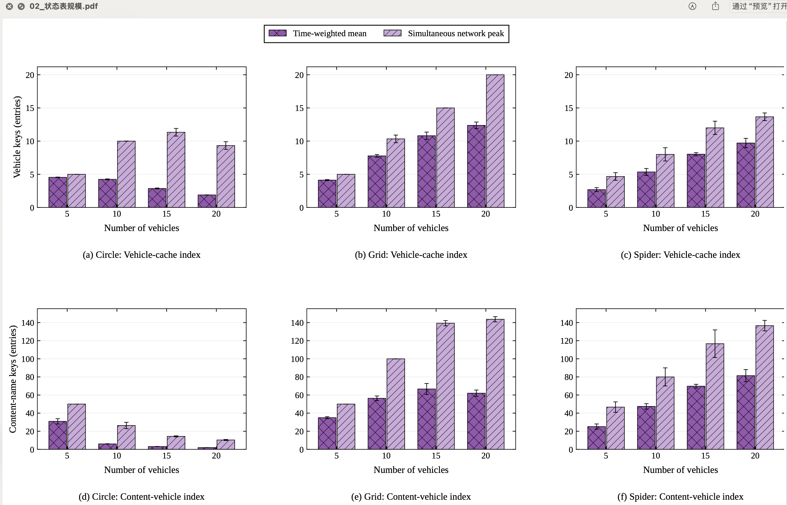
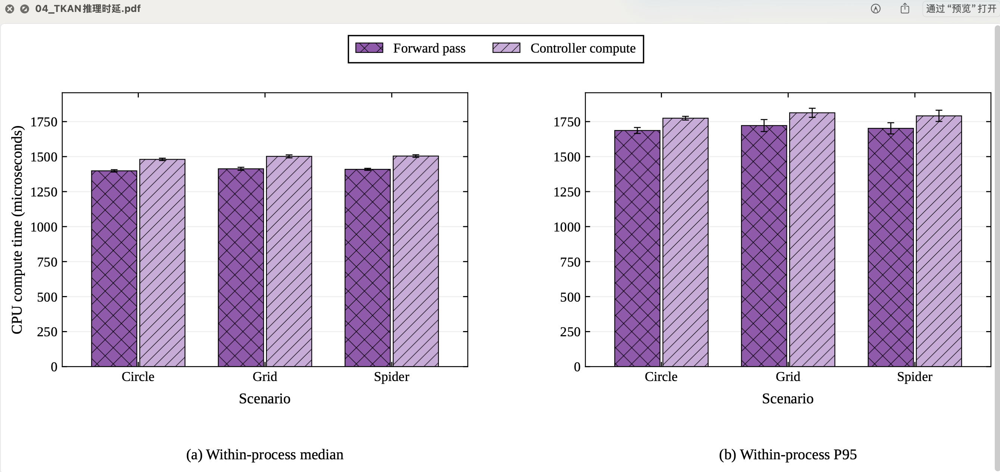
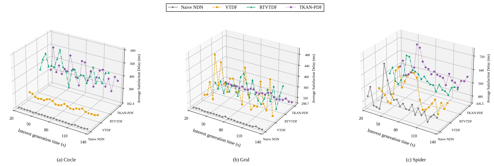
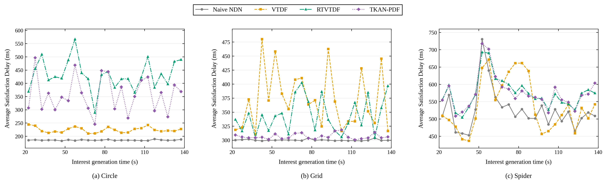
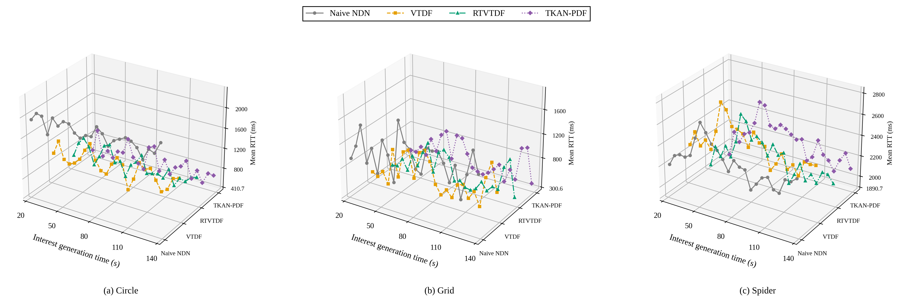
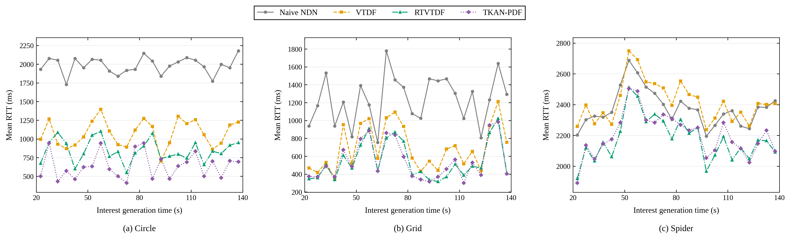
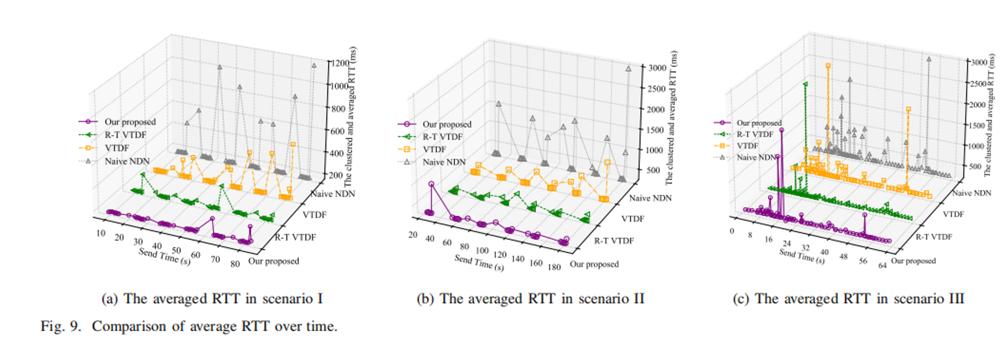
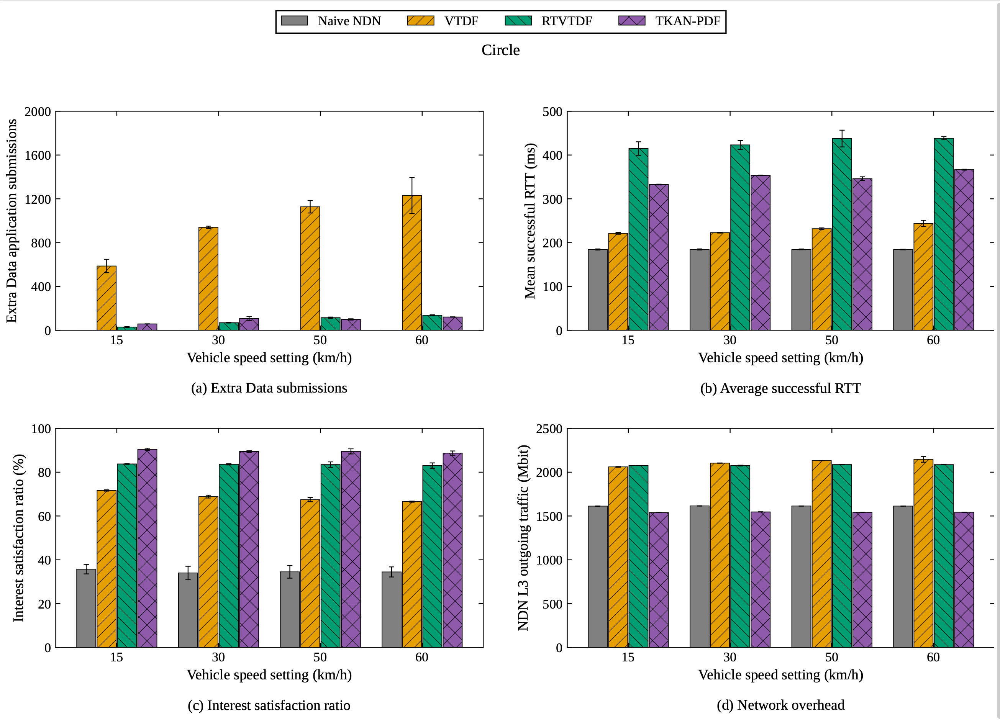
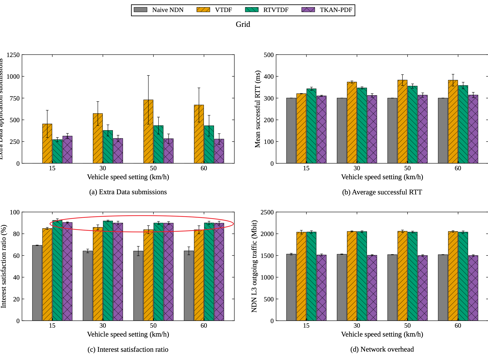

# 问题

**填写依据：[仿真图填充/仿真图.md](仿真图填充/仿真图.md)及同目录绘图脚本内嵌数据；正文解释补充核对了保存的实验记录和当前实现。以下加粗文字为新增回答，原问题和截图保留。**

| Period (ms) | Accuracy | Interaction Numbers |
| --- | --- | --- |
| 20 | **圆圈：99.56%；方阵：97.89%；蜘蛛网：98.98%** | **圆圈：51417.00；方阵：49054.33；蜘蛛网：32521.00** |
| 40 | **圆圈：99.44%；方阵：97.59%；蜘蛛网：99.18%** | **圆圈：27579.33；方阵：24524.33；蜘蛛网：16211.67** |
| 80 | **圆圈：99.52%；方阵：97.71%；蜘蛛网：99.04%** | **圆圈：13893.33；方阵：12260.33；蜘蛛网：8083.67** |
| 160 | **圆圈：99.48%；方阵：97.01%；蜘蛛网：98.83%** | **圆圈：6912.33；方阵：6114.67；蜘蛛网：4044.67** |

**Accuracy 取图1中 All evaluable 的离线 Top-1 预测准确率，先计算各轮准确率，再对三个种子取均值，不是在线兴趣满足率。Interaction Numbers 按用户确认的“车辆信标交互次数”填写：以车辆收到驻留基站信标后，在应用层提交一份 hello Data 回复计一次，包含注册、缓存增量和无变化回复，不另加基站广播 Interest 的次数，也不等于基站成功接收回复的次数。**

**两列使用同一批 NoForward 采样：每场景10辆车、速度设置30 km/h、每轮6000个业务请求、统计窗口 [20,140) 秒，种子为84001、84002、84003；模型在采样后离线评估。交互次数是三个种子每轮全体车辆回复次数的均值，所以可有小数。它不是 TKAN-PDF 在线实验的交互次数，也不是按周期推算的理想值。原始36轮的 hello-payloads.csv 已按该窗口复算并核对封存摘要，逐轮计数见[核验表](../../build/validation/question-answers-20261103/beacon-counts.csv)。准确率来源：[图1脚本](仿真图填充/01_信标周期预测准确率.py)。**

**图1浅紫柱表示交接子集准确率，补充如下，以免把全部样本较高的准确率理解为交接时同样准确：**

| **Period (ms)** | **圆圈交接准确率** | **方阵交接准确率** | **蜘蛛网交接准确率** |
| --- | --- | --- | --- |
| **20** | **96.14%** | **89.54%** | **92.93%** |
| **40** | **95.03%** | **89.09%** | **92.61%** |
| **80** | **95.73%** | **89.25%** | **91.48%** |
| **160** | **95.33%** | **86.33%** | **89.79%** |

为什么不同网络拓扑结构对应两个表的大小不一样

**图中“大小”实际是全网各 RSU 状态表的键数之和，不是每条记录的字节数。上排为“车辆→缓存内容集合”的车辆键数，下排为“内容名称→持有车辆集合”的内容名称键数；同一个键出现在不同 RSU 时分别计数。深紫柱是每轮的时间加权均值再跨三个种子平均，浅紫柱是每轮全网同一时刻的最大条目总数再跨种子平均，并非把各 RSU 不同时刻的峰值相加。**

**拓扑、RSU 布设、车辆轨迹和无线覆盖不同，会改变车辆在各站驻留的时间及信标回复可达性；缓存内容的获得、增删和超时清理又决定了两个索引实际保留多少键。因此，同样10辆车并不意味着三个场景的状态表一样大。图2默认信标周期20 ms，RSU 车辆超时阈值40 ms；当前代码在同步检查时，若距上次回复已超过该阈值，就删除该车的缓存映射。图中圆圈随车辆数增加反而下降，说明实际保留的状态更少，不能将其解释为“车辆越多，单条记录越省内存”；信标丢失、超时清理等因素各贡献多少，单凭这张图尚不能确定。**

**例如图2的10车条件，单位为条，数值为三个种子的均值：**

| **场景** | **车辆键：时间均值** | **车辆键：同时峰值** | **内容键：时间均值** | **内容键：同时峰值** |
| --- | --- | --- | --- | --- |
| **圆圈** | **4.24** | **10.00** | **6.02** | **26.33** |
| **方阵** | **7.77** | **10.33** | **56.39** | **100.00** |
| **蜘蛛网** | **5.35** | **8.00** | **47.43** | **80.00** |

**来源：[图2脚本](仿真图填充/02_状态表规模.py)、[RSU 状态表定义](../../contrib/vndn-nn-rd/apps/vndn-rsu.h)与[同步、清理实现](../../contrib/vndn-nn-rd/apps/vndn-rsu.cc)。**

The structures of NVT and NCT are shown in Figure 4, with each entry being approximately 4B and 5B in size, respectively.（咱们两个表每个条目大小约多少）, which is much smaller than the Data packet (常规返回的内容数据包大小为多少).

**当前不能填写“每条4 B和5 B”。本实现对应的是动态容器 m_vehicleToCs（64位车辆ID→内容名称字符串集合）和 m_csToVehicles（内容名称字符串→64位车辆ID集合），并非参考论文中固定长度的 NVT/NCT 记录。单个车辆ID本身占8 B，但每条映射还包含字符串、集合及容器管理开销，大小随内容名称长度和关联数量变化；现有图只测键数，没有测每条记录或整表的实际内存。因此，这一项应填写“动态长度，实际内存占用尚未测量”，不能从条目数反推出固定字节数。**

**三个场景的常规业务 Data 内容负载均设为10240 B，即10 KiB；完整 NDN 编码包还包含名称、元信息、签名和 TLV 等开销，不能把10240 B写成完整包的精确长度。来源：[圆圈生产者配置](../../scratch/vndn-circle-simulator/vndn-circle-main.cc)、[方阵/蜘蛛网共用生产者配置](../../scratch/vndn-map-simulator-common.h)。在未测状态表内存前，也不能直接断言实际整表或单条记录必定远小于一个 Data 包。**

Furthermore, the synchronization interval T for NVT and NCT is also much larger than the user's request rate. （所以咱们仿真中信标信息发送间隔是设为多少，用户请求速率固定为多少）

**默认信标间隔为20 ms，即每个 RSU 每秒广播50次；图1另扫描40、80、160 ms，分别对应每秒25、12.5、6.25次。周期准确率实验、10车状态/报文实验和车速扫描均为每车每秒5个业务请求，单车平均请求间隔200 ms；10辆车的全网速率为50请求/秒，120秒共6000个请求。**

**原英文把“时间间隔”和“请求速率”直接比较，量纲不一致。按单车比较，应写“默认20 ms信标间隔小于200 ms业务请求间隔”，或者“50 Hz信标广播频率高于5 Hz单车业务请求频率”。这不是说所有实验都固定全网50请求/秒：消费者数量扫描保持每车5请求/秒，全网随5/10/15/20辆车变为25/50/75/100请求/秒；请求速率扫描则固定10辆车，全网扫描12.5/25/50/75/100请求/秒。来源：[图集使用说明](仿真图填充/使用说明.md)。**

a和b两个图什么意思，图中每个柱状体代表什么意思，具体数值是多少

**此截图对应图集的图4。(a) 为每个独立进程内1000次计时的中位数，再对5个进程取均值；(b) 为每个进程内计时的第95百分位数（P95），再对5个进程取均值。深紫色 Forward pass 仅计模型前向计算，浅紫色 Controller compute 包含输入整理、归一化、模型前向、softmax 和候选基站概率映射。浅紫柱已经包含前向计算，不能把两柱相加当作总时延。**

**下表单位为微秒（μs），每格为“柱高 ± 误差线”，误差线为5个进程统计值的样本标准差，不是置信区间：**

| **场景** | **(a) 前向中位数** | **(a) 控制器中位数** | **(b) 前向P95** | **(b) 控制器P95** |
| --- | --- | --- | --- | --- |
| **圆圈** | **1398.36 ± 8.35** | **1480.18 ± 8.52** | **1686.55 ± 21.31** | **1774.45 ± 13.18** |
| **方阵** | **1413.04 ± 10.79** | **1501.73 ± 10.48** | **1721.88 ± 42.84** | **1813.06 ± 32.38** |
| **蜘蛛网** | **1409.10 ± 7.22** | **1504.06 ± 9.14** | **1701.93 ± 40.06** | **1791.08 ± 40.25** |

**测量环境为 Intel Core i7-14700、CPU单线程、batch=1，每个进程预热100次；排除模型加载、Gym等待和I/O。它是本机实际计算时间，不是 ns-3 模拟时间中的业务 RTT。来源：[图4脚本](仿真图填充/04_TKAN推理时延.py)与[计时实现](../../tools/experiments/followup_benchmark.py)。**

update和registration两个数据包大小（具体数值）、TKAN推断时延（写数值即可）

**对应图3和图4，可直接填写以下数值；时延采用纯模型前向的进程内中位数之跨进程均值，换算为毫秒：**

| **场景** | **update：平均完整NDN编码大小（B）** | **registration：平均完整NDN编码大小（B）** | **TKAN推断时延（ms）** |
| --- | --- | --- | --- |
| **圆圈** | **185.46** | **111.00** | **1.398** |
| **方阵** | **186.79** | **108.07** | **1.413** |
| **蜘蛛网** | **185.75** | **109.57** | **1.409** |

**报文数值对应 TKAN-PDF 在线运行、10辆车、20 ms信标周期；registration 取启动窗 [0,20) 秒的注册回复，update 仅取测量窗 [20,140) 秒中有缓存增删的 delta 回复，不包括所有无变化 hello。先计算各轮平均包长，再平均三个种子，所以有小数；是编码后的完整 hello Data 大小，不含 LP/MAC 开销，也不是固定的包长常量。启动时缓存为空或很少，而后续增量可能携带新增和删除名称，因此本组 update 均值大于 registration 均值。若需包含输入处理等完整控制器计算，其中位数均值分别为1.480、1.502、1.504 ms。来源：[图3脚本](仿真图填充/03_注册与更新报文大小.py)、[图4脚本](仿真图填充/04_TKAN推理时延.py)。**
**成功请求 RTT：三维图（由下方独立脚本生成）**

这张图线条和标注都没有对齐，干脆不要弄成三维图了，横坐标Interest generation time，纵坐标 Average Satisfaction Delay （ms）

**已增加圆圈、方阵、蜘蛛网三个并列的二维折线子图，每个子图保留四条策略曲线；横轴为 Interest generation time (s)，纵轴为 Average Satisfaction Delay (ms)，策略名称放在图例中。成功请求的三维图和折线图使用同源统计的288个绘图值，与[原图5脚本](仿真图填充/05_三场景RTT时间变化.py)一致。**

**统计窗口为请求生成时刻的 [20,140) 秒，每5秒一箱，横坐标为各箱中心22.5、27.5……137.5秒。Circle、Grid分别沿用23001、23009种子的原单轮基准；Spider使用2026-11-03保存的16.5 dBm独立复核种子93001～93005，每策略5轮，RSU与OBU均为16.5 dBm。每箱合并所选种子的成功请求，以成功耗时总和除以成功数，按成功请求数加权，不对各轮成功均值简单平均。空分箱保持缺失，不补0。**

**含超时的平均 RTT：三维图与折线图**

**下方两图使用与成功RTT图相同的28轮原始请求记录和5秒分箱，将每个窗口内生成的全部请求纳入均值：成功请求计从发送到收到 Data 的实际耗时，超时请求计从发送到超时终结的实际等待时间。本批超时均严格为3000 ms。因此，每箱平均 RTT＝（成功请求实际耗时之和＋3000 ms×超时数）÷该箱生成请求数。该指标包含失败请求的等待代价，并非只对成功收包求平均。按用户要求，图轴统一写 Mean RTT (ms)。**

**原始记录共168000个请求，其中71510个成功、96490个超时，无其他终态；Circle/Grid每个“场景×策略×5秒箱”有250个生成请求，Spider合并5轮后每箱1250个。Spider本身共120000个请求、34628个成功、85372个超时。样本按生成时刻归箱，即使请求在箱外或排空期才结束，其完整耗时仍计入原生成箱。两种图形只改变展示方式，不改变各自统计值；本次正式曲线全部复用保存数据；默认功率另做工程短测，其结果不进入图表。逐箱计数、成功/超时耗时总和及两种均值见[RTT分箱数据.csv](问题图片/RTT分箱数据.csv)，CSV保留672行原始“场景×策略×种子×5秒箱”，Spider绘图时每5行同策略同时间箱合并，最终每图288个绘图值。原始路径、种子与摘要见[RTT数据来源.json](问题图片/RTT数据来源.json)。**

**两个三维图均按场景独立设置 z 轴下限，取该场景四条曲线的实际最小值；保留真实 RTT 刻度，不把数值减去最小值后归零。成功 RTT 图的圆圈/方阵/蜘蛛网下限约为182.39/298.72/436.55 ms，含超时图约为410.68/300.59/1890.73 ms；因此子图坐标范围不同，比较时应看刻度和数值。**

| **内容** | **独立出图脚本（数据内嵌）** |
| --- | --- |
| **成功请求 RTT 三维图** | **[01_成功RTT_三维.py](问题图片/01_成功RTT_三维.py)** |
| **成功请求 RTT 折线图** | **[02_成功RTT_折线.py](问题图片/02_成功RTT_折线.py)** |
| **含超时平均 RTT 三维图** | **[03_平均RTT含超时_三维.py](问题图片/03_平均RTT含超时_三维.py)** |
| **含超时平均 RTT 折线图** | **[04_平均RTT含超时_折线.py](问题图片/04_平均RTT含超时_折线.py)** |

**每份脚本都完整内嵌数据，仅依赖 Python、NumPy 和 Matplotlib，可单独复制到其他目录运行，不读取原实验、CSV或其他脚本。在 ns-3 目录执行例如 `python3.8 docs/ai/问题图片/04_平均RTT含超时_折线.py`，会在脚本旁生成同名 PNG、SVG、PDF；再次运行只覆盖该脚本对应的三份图片。顶部可调整字体、尺寸、颜色、视角和坐标范围，末尾 DATA 可编辑绘图值。手工修改后来源记录不会自动更新，应保留与原实验数据的区别。**

**以下保留旧论文参考图，供讨论新旧结果差异：**

你看你之前画的，ai画的和你的不一样。

**两组图的差异首先来自实验数据和统计定义不同，不能只通过调整画法把曲线变成一样。旧图是旧手写实现的历史数据；原图集图5和上方成功请求 RTT 两图使用重写版本的固定模型实验数据，按5秒分箱，只统计期限内成功请求的 RTT。旧归档 RTT CSV 同时记录成功收包和超时终结耗时，包含大量3000 ms记录；旧三维脚本还按每20条（圆圈）或40条（方阵、蜘蛛网）记录分组平均，而非固定5秒分箱。本次新增的含超时平均 RTT 两图已纳入超时等待，但仍保留当前实验的数据、种子和5秒分箱，不能与旧图视为同条件复现。**

**因此旧图中 Naive 的较高尖峰可能含超时耗时，上方成功请求图中的 Naive RTT 较低也不代表其交付更好：未成功的请求没有进入成功 RTT 均值，而新增含超时图会计入这部分等待代价。实现、模型、发包与取样方式也存在差异。虽然已提供二维版式，若要比较新旧算法性能，仍需要相同条件、相同成功/超时口径的对照，不能靠改图复现原来的优势。来源：[旧论文实验与出图记录第4～5节](旧论文实验与出图记录.md)、[当前图集口径](仿真图填充/使用说明.md)。**

这张图1中咱们算法为什么会二次转发数据包个数比rtvtdf的还高，图4 中为什么咱们总的数据流量比其他的都少，这个总的数据流量=控制包数量+兴趣包数量+数据包数量+二次转发数量？

**此截图对应图集图6的圆圈车速扫描。左上角(a)的准确名称是“额外 Data 应用提交次数”，并不都是“车辆离开后再二次转发”。16轮原始 data-attempts.csv 已核验：这四档中 TKAN-PDF 的额外次数全部为 PREDICTIVE_EXTRA，即预测选择两个候选基站时多提交的回程分支；RTVTDF 的额外次数全部为 REACTIVE_RELAY，即事后补救转送。两个种子的均值如下：**

| **车速设置（km/h）** | **VTDF额外提交（次）** | **RTVTDF额外提交（次）** | **TKAN-PDF额外提交（次）** |
| --- | --- | --- | --- |
| **15** | **586.5** | **29.5** | **58.0** |
| **30** | **939.5** | **69.0** | **107.0** |
| **50** | **1127.0** | **115.0** | **99.0** |
| **60** | **1231.0** | **137.5** | **121.0** |

**所以“比RTVTDF更多”只出现在15、30 km/h，50、60 km/h时更少。双路径用额外副本换取选站不确定时的交付机会，因此不能要求它在所有条件下都比单次事后补救少；这些次数也不等于成功补救次数或全部链路上的副本数。当前规则在前两名概率差不超过0.10，或第二名概率至少0.10时可选两条回程路径。来源：[图6脚本](仿真图填充/06_车速_圆圈.py)、[Router额外分支记录](../../contrib/vndn-nn-rd/apps/vndn-router.cc)。**

**右下角(d)统计的是字节换算的累计 Mbit，不能用“控制包数量＋兴趣包数量＋数据包数量＋二次转发数量”得到。统一关系为：网络总负载＝各网络 Face 出站的 Interest/Data 完整NDN编码字节之和×8/1000000。按互斥用途分解，也可写成“业务 Interest/Data 字节＋携带业务 Data 的补救封装字节＋自定义控制字节”。控制消息本身也是 Interest 或 Data；额外副本及补救封装一旦出站已经计入总量，不能再加一次。此口径包含测量及排空期，不包含 LP/MAC 头、无线重试等全部空口成本。**

**以图6的30 km/h、10车、6000请求条件为例，两个种子均值，单位 Mbit：**

| **策略** | **自定义控制** | **业务Interest/Data** | **补救封装** | **总网络负载** |
| --- | --- | --- | --- | --- |
| **Naive NDN** | **133.175284** | **1481.749020** | **0.000000** | **1614.924304** |
| **VTDF** | **132.872992** | **1867.730272** | **102.943444** | **2103.546708** |
| **RTVTDF** | **119.246864** | **1944.755632** | **11.437264** | **2075.439760** |
| **TKAN-PDF** | **52.606456** | **1494.005880** | **0.000000** | **1546.612336** |

**这说明额外提交次数较多与总字节更少并不矛盾：次数指标既不按包长加权，也不累计每一跳。TKAN-PDF 在这个点的业务字节比 Naive 多12.256860 Mbit，但控制字节少80.568828 Mbit，因此总量少68.311968 Mbit。与 RTVTDF 比，业务和补救封装字节也更少。控制量下降包含神经方案专用的无损紧凑 hello 编码、无变化缓存增量省略的作用，不能全部归于模型预测准确。它仍有神经路由/预备PIT控制成本；不能写成没有额外控制包。该表支持这个基准点的字节分解，不代表所有负载下总量都最低。来源：[保存的流量分解表](diagnostics/f02-f04-diagnosis-20261028/control/control-network-means.csv)、[F02/F04解释](F02时延与F04控制负载解释_20261028.md)、[采集口径](实验采集运行与汇总指南.md)。**

这里为啥咱们算法的优势这么低，甚至比别人的差劲

**此截图对应图集图7的方阵车速扫描。就兴趣满足率而言，TKAN-PDF 在四档的中心值确实均低于 RTVTDF，应保留这一结果，不能改写为“全面更优”。每档两个种子的均值如下：**

| **车速设置（km/h）** | **RTVTDF满足率** | **TKAN-PDF满足率** | **TKAN-PDF－RTVTDF（百分点）** |
| --- | --- | --- | --- |
| **15** | **92.32%** | **90.38%** | **−1.93** |
| **30** | **91.78%** | **89.88%** | **−1.89** |
| **50** | **89.88%** | **89.78%** | **−0.09** |
| **60** | **89.98%** | **89.76%** | **−0.23** |

**差值按未舍入的中心值计算。不能只凭两次重复和标准差误差线声称差异显著。回程预测只改善“Data 应送往哪座RSU”，不能保证无线请求已到站、预测站始终可达，或返回的Data能完整交付。图1方阵20 ms的全样本预测准确率为97.89%，交接子集为89.54%；这些是另三个种子的离线分类结果，不能直接当作图7的在线交付率，也不能用两者之差计算本图丢包原因。**

**已有同批数据的方阵负载诊断发现，从1500到12000请求，TKAN-PDF 满足率下降约8.85个百分点，其中约8.52个百分点来自“RSU已向无线出口提交Data、但目标车辆未完整接收”的损失增长。这支持继续检查无线末段及目标站可达性；但该诊断不是图7四个车速点逐点的因果分解，尚不能断言本图差距全部由预测错误、拥塞或某一项实现问题造成。现有记录也未分离MAC排队、重试和分片损失的各自贡献。来源：[F01诊断的Grid部分](F01兴趣满足率诊断_20261028.md)。**

**图7同时体现了代价与交付率的取舍：30 km/h时，TKAN-PDF 成功请求平均RTT为312.34 ms，RTVTDF为346.97 ms；总网络负载分别为1505.61和2050.08 Mbit，前者约低26.56%，但满足率低约1.89个百分点。因而当前可写成“在这些方阵条件下减少网络负载、降低成功请求平均时延，但未取得更高的兴趣满足率”，不能只凭流量更低就认定整体更好，也不能把包含报文编码优化的全部收益归于神经模型。来源：[图7脚本](仿真图填充/07_车速_方阵.py)。**
